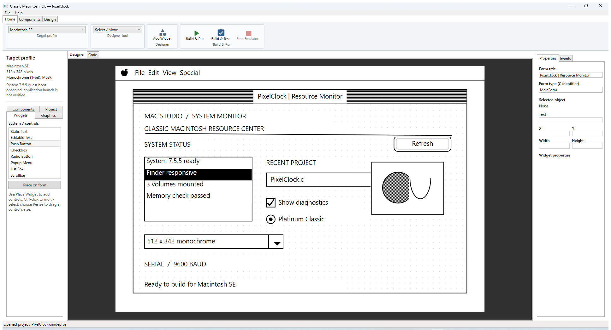
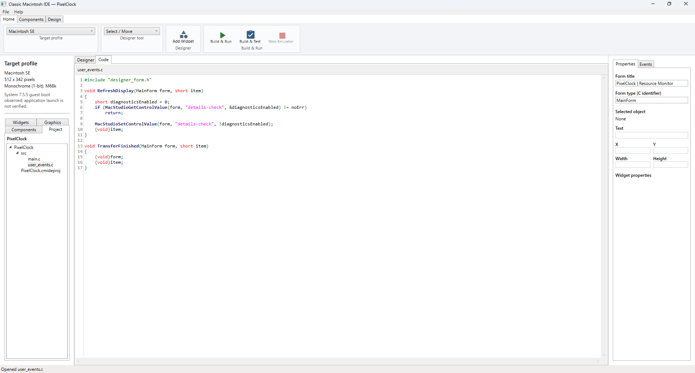
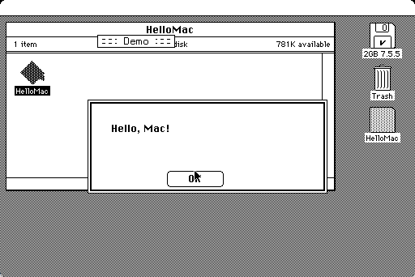
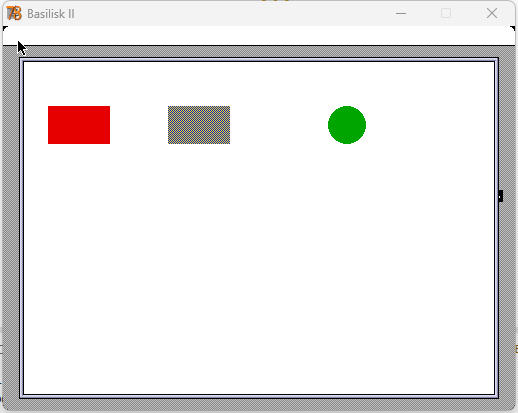

# FreeRTOSx86Studio

FreeRTOSx86Studio is a Windows WPF application for visually designing GUI
applications that run as FreeRTOS tasks under MS-DOS. It is a separate copy of
ClassicMacStudio, with an 8088/Hercules target and an Open Watcom DOS runtime.
The copied Macintosh documentation and resources remain available for the
inherited project material; the DOS-specific workflow is described below.

Why? Because I am a retro computer collector and having those machines makes me
wonder if I can actually do something useful with them, such as writing a game 
for them. Secondly, I share this to help my fellow collectors to enjoy their systems
more too. 

The IDE includes:

- A 720 × 348 monochrome Hercules designer for 8088 DOS GUI tasks, with
  generated C widgets, event hooks, and a 8086-compatible assembly graphics
  backend.
- Target-aware form designers for the 512 × 342 monochrome Mac SE, 512 × 384
  Macintosh Color Classic, and 640 × 400 PowerBook 165c. Color QuickDraw
  graphics expose editable RGB properties on color targets.
- Adjustable designer grid and snap, eight-direction widget resize grips,
  alignment and line-end grips, widget properties, and a separate QuickDraw
  graphics palette.
- Form-level properties for title-bar visibility, resizing, close/zoom boxes,
  launch visibility, centering, initial position, and client dimensions.
- Project persistence, project/file tree, C editor with syntax highlighting,
  component tray, event bindings, and generated C/Rez application sources.
- Classic controls, graphics, Standard File, menu, serial, XMODEM, and ZMODEM
  component definitions and generated runtime support.
- A separate System 7 Serial Agent prototype for remote Mac deployment and
  debug-record testing. See the [Agent build and deployment guide](docs/serial-agent-deployment.md);
  physical Mac operation remains unverified.
- An 8088 DOS serial debug Agent and a VS Code/Copilot-only Python MSAG v1
  peer for LVGL telemetry. The Python peer is not exposed in the IDE. See the
  [DOS Agent debugging guide](docs/dos-agent-debugging.md).
- Build & Run workflows using Retro68, WSL, Mini vMac or Basilisk II, and a
  disposable System 7 volume. Build & Test uses Mini vMac and its HFS mailbox.
- Offline in-IDE help. Open **Help → IDE Help** for the setup guide, developer
  manual, and the C/Retro68 language reference.

Compatibility is deliberately conservative. The Mac SE / System 7.5.5 profile
has a visible application launch in Mini vMac. Generated color QuickDraw smoke
apps also rendered in Basilisk II with Color Classic and PowerBook 165c ROMs.
Those color profiles remain candidates for exact-hardware compatibility:
Basilisk II was configured with its generic Mac IIci model ID 5, not those
machines' hardware, and the smoke run does not establish general application
compatibility. **Run → Basilisk II** enables Build & Run for the two color
profiles; automated Build & Test remains limited to Mini vMac and Mac SE.
Standard Dialog Manager controls keep the guest system's appearance.
QuickDraw graphics accept `#RRGGBB` color values on color targets; monochrome
projects retain black and dithered rendering.

MAME 0.289 recognizes the exact Color Classic (`maccclas`) and PowerBook 165c
(`macpb165c`) models, and the local main ROM images match MAME's corresponding
ROM definitions. Guest boot is not yet possible with the local files: Color
Classic needs the separate CUDA firmware set, while PowerBook 165c also needs
the PowerBook video and PMU firmware. No ROMs or system disks are included or
distributed by this project. See the [compatibility matrix](docs/compatibility-matrix.md)
for the current verification state.
The installed Mini vMac variation is SE-only, and its official variation
service does not list either color model. Basilisk II provides the working
color-app path, but it does not verify exact Color Classic or PowerBook
hardware emulation.

## Standalone Project

This directory contains the separate FreeRTOSx86Studio copy, its core library,
tests, runtime, and supporting tools. See the [documentation index](docs/README.md) and
[tutorial projects and guides](tutorial/README.md). RetroLink is maintained
separately and is not required to build or run the IDE.

## DOS FreeRTOS GUI runtime

The implemented target is 8088-compatible DOS with Hercules graphics
(720 × 348, 1 bpp). The generated task draws through the `gui_*` C API and the
8088 assembly backend. The 80386/VGA profile is a future target. XMS is future
work, and the GUI runtime currently keeps FreeRTOS objects and drawing data in
conventional memory; the separate DOS POC's EMS test is not wired into this
GUI runtime.

Install the .NET 10 SDK, Open Watcom 2.x (default `C:\WATCOM`), and DOSBox-X.
The runtime expects `FreeRTOS-LTS` and `dosbox-x` alongside the `dosrtos`
repository directory. Open the IDE, create or open a DOS 8088/Hercules project,
save it, then use **Build & Run**. The Material Design ribbon groups project
commands under **Project** and LVGL tools under functional tabs (**Controls**,
**Data**, **Containers**, **Media**, **Drawing**, and **Design**). The widget
palette currently uses text entries; icon tiles with compact labels for every
widget are planned. The central workspace currently exposes generated,
read-only `gui_task.c` alongside editable `user_events.c` and generated
`user_events.h`. The planned application-oriented editor will hide the RTOS
task implementation and let users work with the program and event handlers as
an application. The property pane currently provides a manually editable
`OnClick` handler field; activating an event to generate/open its handler
snippet is planned.

The designer's grid spacing and snap behavior are configurable from the
toolbar. Drag a line's start or end handle to reshape it without a rectangular
selection frame; other widgets retain perimeter resize grips. Build Output is
below the designer and code tabs, with a vertical splitter for adjusting its
height. Resizing and validating the other tool panes remains planned. Saving
the project persists the edited event source in its `generated` folder.

To build and launch a saved generated project directly:

```powershell
.\runtime\8088\build-and-run.ps1 -ProjectDirectory "C:\path\to\saved-project"
```

Run the bounded smoke test instead of the interactive app with:

```powershell
.\runtime\8088\build-and-run.ps1 `
  -ProjectDirectory "C:\path\to\saved-project" `
  -SmokeTest
```

The smoke test builds with 8086-compatible flags and checks that the generated
FreeRTOS task starts and draws its form under DOSBox-X with 640 KiB of
conventional memory. The current successful run covers generated text, lines,
outlined and filled rectangles, buttons, and outlined and filled circles.
The [reusable Hercules LVGL sample project](runtime/8088/examples/hercules-lvgl-demo/README.md)
includes the saved WYSIWYG form and generated C files. A DOSBox-X guest capture
is saved at
[`runtime/8088/evidence/lvgl-demo/hercules-lvgl-demo.png`](runtime/8088/evidence/lvgl-demo/hercules-lvgl-demo.png).
The interactive Build & Run workflow was also verified from the IDE; its
running Hercules guest is captured at
[`runtime/8088/evidence/lvgl-demo/hercules-lvgl-demo-build-run.png`](runtime/8088/evidence/lvgl-demo/hercules-lvgl-demo-build-run.png).
Serial-mouse interaction has not been hardware-verified.
See the [porting plan](PORTING_PLAN.md) for target boundaries and remaining
work.

## Screenshots

The PixelClock example below is shown in the running IDE's form designer and
syntax-highlighted C editor. The guest screenshot shows a built application
running in Mini vMac with the Mac SE / System 7.5.5 setup.

### WYSIWYG form designer



### C source editor



### Mini vMac guest application



### Basilisk II Color QuickDraw



The generated red, dithered blue/cyan, and green shapes were launched from
System 7 Startup Items in Basilisk II using a disposable boot volume. The
PowerBook 165c ROM run is also captured in the
[compatibility evidence](docs/compatibility-matrix.md).

## License

This repository is licensed under GNU GPLv3; see [LICENSE](LICENSE).

## Requirements

- 64-bit Windows 10/11 with Visual Studio Code or Visual Studio (for editing
  and development).
- .NET 10 SDK (the IDE is a WPF `net10.0-windows` application).
- WSL 2 with an Ubuntu distribution, `git`, CMake, and the packages listed in
  [Retro68 setup](#build-the-retro68-toolchain).
- Retro68's 68k GCC and Rez tools built under the WSL user's home directory.
- For Mac SE runs, a Mini vMac build configured for a Macintosh SE. For color
  profile runs, the Basilisk II Windows build and the corresponding Color
  Classic or PowerBook ROM. A legally usable ROM and System 7 disk image are
  required; none are distributed with the project.
- Deno is needed only for the repository's full `deno task test:all`
  validation; it is not needed to launch the IDE or build a form.

Install .NET 10 from the
[.NET downloads page](https://dotnet.microsoft.com/download/dotnet/10.0).
Install WSL 2 and Ubuntu using Microsoft's
[WSL installation guide](https://learn.microsoft.com/windows/wsl/install).
Install Deno from the [official Deno installation guide](https://docs.deno.com/runtime/getting_started/installation/)
only if you plan to run the full validation task.

## Get the workspace ready

Clone this repository and open its root directory in Windows. Do not copy
copyrighted Macintosh ROMs, operating-system disks, or emulator assets from
another party into Git. The repository ignores `*.ROM`, `*.rom`, `*.dsk`, and
`.local-tools/`; keep all local media and binaries there or in the ignored
`images/` folder.

### 1. Install WSL Ubuntu and build Retro68

If WSL 2 and Ubuntu are not already installed, install them using Microsoft's
Windows instructions. In an elevated PowerShell, install Retro68's Ubuntu build
prerequisites:

```powershell
wsl.exe -d Ubuntu -u root -- apt-get update
wsl.exe -d Ubuntu -u root -- apt-get install -y --no-install-recommends `
  cmake libgmp-dev libmpfr-dev libmpc-dev libboost-all-dev bison flex texinfo ruby git
```

From the repository root, build the toolchain:

```powershell
wsl.exe -d Ubuntu -- bash scripts/wsl/build-retro68.sh
```

The script clones Retro68 into `~/retro68-src` and builds the toolchain in
`~/retro68-build`. It checks for:

- `~/retro68-build/toolchain/bin/m68k-apple-macos-gcc`
- `~/retro68-build/toolchain/bin/powerpc-apple-macos-gcc`
- `~/retro68-build/toolchain/bin/Rez`

The current IDE build workflow uses the 68k GCC and Rez tools. The PowerPC
compiler is installed by the reproducible toolchain script but is not a
verified IDE target.

### 2. Install local emulator assets

Place the assets at these default paths relative to the repository root:

```text
images\
  OS_755_2GB.dsk
  256KB ROMs\
    1987-03 - B2E362A8 - Mac SE.ROM
.local-tools\
  emulators\
    MiniVmac-SE\
      Mini vMac.exe
    BasiliskII\
      BasiliskII.exe
```

For Basilisk II color runs, keep the corresponding 1 MB ROM under
`images\1MB ROMs\` (the default Color Classic and PowerBook ROM names are
listed in the compatibility matrix). The IDE passes the selected ROM
explicitly, uses a disposable copy of the System 7 HFS volume, and launches the
generated application from Startup Items. Basilisk II runs with generic model
ID 5; this is a color-rendering/app-launch test, not exact Color Classic or
PowerBook hardware emulation.

`OS_755_2GB.dsk` is the source System 7.5.5 disk image used by the current
scripts. The ROM must be the Mac SE ROM accepted by the boot helper; it checks
the expected ROM hash before launch. The emulator executable must be a Windows
Mini vMac variation configured for a Mac SE and compatible with the ROM. The
Windows variation can be generated with the
[Mini vMac variation service](https://www.gryphel.com/c/minivmac/var_serv.html);
select a Macintosh SE and Windows target when configuring it. The boot helper
copies it to a temporary directory, gives the temporary ROM the name
`MacSE.ROM`, extracts a disposable HFS boot volume, and adds a separate
application disk. It does not modify the source disk or ROM.

If your file names or locations differ, the PowerShell scripts accept explicit
`-DiskImagePath`, `-RomImagePath`, and `-EmulatorPath` arguments. The IDE's
current Build & Run workflow uses the defaults above.

> System software and ROM images are not included. Obtain and use them only if
> you have the right to do so. Never commit them to this repository.

### 3. Build and launch the IDE

```powershell
dotnet build src\ClassicMacIde.App\ClassicMacIde.App.csproj
dotnet run --project src\ClassicMacIde.App\ClassicMacIde.App.csproj
```

The IDE is a Windows desktop WPF application. Open an existing `.cmideproj`
project or use **File → New Project**. Add controls and components, edit
properties and event bindings, then use **Home → Build & Run** or **Build &
Test**.

Generated project sources are stored under the project's `src` directory;
build output is kept in the project `.build` directory. For an unsaved
temporary project, the IDE uses `.local-tools/designer-form/`. The build
workflow invokes PowerShell, copies the source into WSL, invokes Retro68, and
launches the resulting app in the selected emulator. Choose **Run → Mini vMac**
for the Mac SE or **Run → Basilisk II** for the Color Classic and PowerBook
165c profiles. Build & Test is available only for Mini vMac / Mac SE. Build
output appears in the IDE.

## First-run checks

Check the toolchain from PowerShell:

```powershell
.\scripts\windows\verify-toolchain.ps1
```

Build the sample application and start it in the guest:

```powershell
.\scripts\windows\build-and-run-mac-se.ps1
```

You can also boot the supplied System 7 disk without building an application:

```powershell
.\scripts\windows\boot-mac-se.ps1 `
  -DiskImagePath .\images\OS_755_2GB.dsk `
  -RomImagePath ".\images\256KB ROMs\1987-03 - B2E362A8 - Mac SE.ROM"
```

For a Basilisk II PowerBook 165c run, the default local ROM and display
settings can be selected with:

```powershell
.\scripts\windows\build-and-run-mac-se.ps1 `
  -Emulator BasiliskII `
  -TargetProfileId mac-powerbook-165c-68k `
  -GuestScreenWidth 640 `
  -GuestScreenHeight 400
```

The Color Classic profile uses `-TargetProfileId mac-color-classic-68k` and a
512 × 384 display. Both color runs use Basilisk II's generic model ID 5 and are
not exact-model compatibility claims.

For the complete feasibility setup, direct build/boot commands, and toolchain
details, see [feasibility/README.md](docs/toolchain-and-emulators.md).

## Serial and transfer components

The Serial Port component uses the Macintosh Modem or Printer serial driver.
Mini vMac does not provide serial-device passthrough; test transfers with
real serial hardware or an emulator backend that exposes a serial connection.
The IDE's **Window → Serial Terminal** opens a Windows COM port as an ASCII
8-N-1 terminal. It also configures Basilisk II's `--seriala` (Modem) or
`--serialb` (Printer) endpoint for the next run. A virtual null-modem pair is
required to connect the two endpoints; this IDE does not install or create a
virtual COM driver. On Windows, [com0com](https://com0com.sourceforge.net/)
can provide the paired virtual serial ports; configure one endpoint for the IDE
terminal and its partner for Basilisk II. If com0com is unsupported on your
Windows version, [Eterlogic Virtual Serial Ports Emulator
(VSPE)](https://eterlogic.com/Products.VSPE_Download.html) is another option;
check its current Windows support and licensing. The configured VSPE pair
COM30 (IDE) and COM31 (Basilisk II Serial A / Modem) has been verified at
9600 baud, 8-N-1, with successful traffic in both directions. This validates
the Basilisk II emulator path only, not a physical Macintosh connection.

Open [the Serial Terminal demo project](tutorial/samples/serial-terminal/SerialTerminal.cmideproj)
to inspect and build the Color Classic sample. Configure Basilisk's COM port
and its paired IDE COM port in the terminal window, apply the Basilisk
settings, connect the IDE endpoint, then choose **Run → Basilisk II** and
**Build & Run**. The guest application opens its Modem component at 9600 baud,
8-N-1, and sends/receives ASCII lines. The COM30/COM31 pair has been verified
with successful host-to-guest and guest-to-host exchanges.

The generated XMODEM implementation supports checksum, CRC, and 1K variants;
the ZMODEM implementation supports CRC-16/CRC-32 negotiated transfers and
bounded memory-buffer receive. See the in-IDE help and
[developer manual](docs/developerManual.md) for APIs, limits, and protocol notes.

## Development and validation

```powershell
dotnet test tests\ClassicMacIde.Core.Tests\ClassicMacIde.Core.Tests.csproj
dotnet build src\ClassicMacIde.App\ClassicMacIde.App.csproj
```

To run the repository's broader validation suite, install Deno and run:

```powershell
deno task test:all
```

Unit tests and successful cross-compilation do not establish guest behavior.
Run the app in the configured emulator (or target hardware) to validate guest
rendering and hardware I/O. See [IMPLEMENTATION-PROGRESS.md](docs/implementation-progress.md)
for the current verification record.
