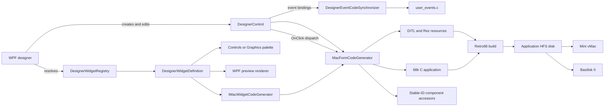
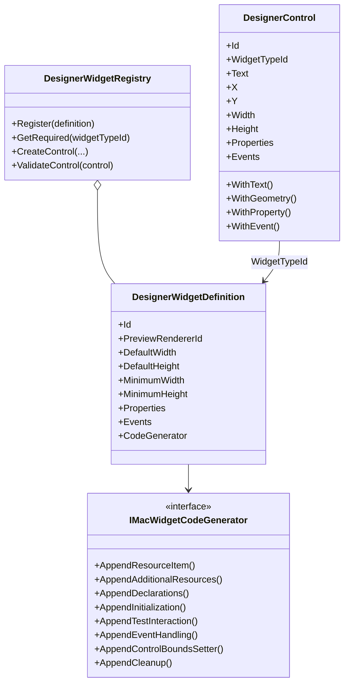
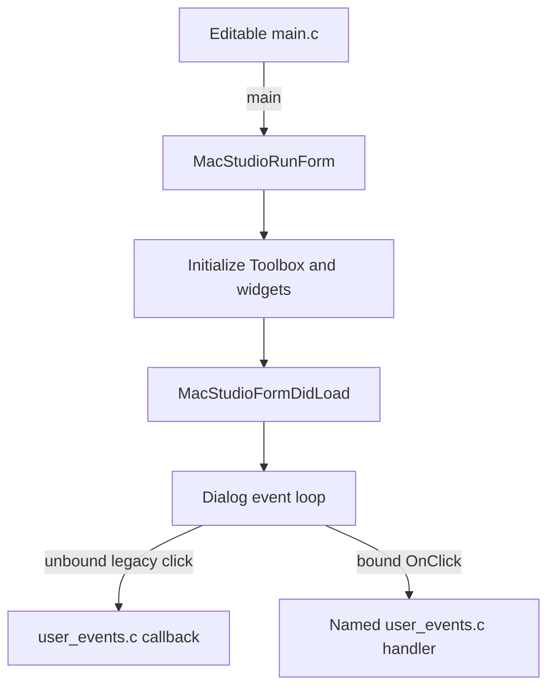

# ClassicMacStudio Developer Manual

## Scope and compatibility

This IDE runs on Windows and generates Macintosh 68k applications. A
Macintosh SE / System 7.5.5 app launch was verified in Mini vMac, and generated
color QuickDraw smoke apps were launched with Color Classic and PowerBook ROMs
in Basilisk II. The designer stores widget geometry in target-screen pixels.

| Target profile | Designer display | State |
|---|---|---|
| Macintosh SE | 512 × 342, 1-bit monochrome | Mini vMac app launch verified on the System 7.5.5 setup |
| Macintosh Color Classic | 512 × 384, 8-bit color | Basilisk II Color QuickDraw smoke app rendered; exact hardware profile remains a candidate |
| PowerBook 165c | 640 × 400, 8-bit color LCD | Basilisk II Color QuickDraw smoke app rendered; exact hardware profile remains a candidate |

Select **Run → Mini vMac** for the Mac SE, or **Run → Basilisk II** for the two
color profiles. Build & Test remains limited to Mini vMac and Mac SE. Basilisk
II ran with generic model ID 5 (Mac IIci), using the Color Classic or
PowerBook ROM and target-sized 8-bit display windows; it does not emulate
those exact hardware models. These app runs validate generated color drawing
in that setup, not full hardware or application compatibility. MAME recognizes
the exact color models, but the additional firmware needed to boot them is not
present locally. MAME reports 640 × 480 output geometry for the PowerBook, so
its mapping to the native 640 × 400 LCD remains unverified.

The eight-widget showcase builds with Retro68 and has completed a Mini vMac
Build & Test run on the Mac SE/System 7.5.5 profile. Guest telemetry reported
all eight widget types and handled clicks for all seven interactive types.
Pixel-by-pixel visual comparison against a physical System 7 desktop remains
pending.

The built-in catalog contains the classic System 7 controls listed below. It
does not include custom CDEFs, appearance-era controls, or later convenience
widgets.

| Widget | Classic implementation | Designer properties |
|---|---|---|
| Static Text | DITL `StaticText` | Text |
| Editable Text | DITL `EditText` | Text |
| Push Button | DITL `Button` | Text |
| Checkbox | DITL `CheckBox` | Text, checked |
| Radio Button | DITL `RadioButton` | Text, group, selected |
| Popup Menu | DITL button plus a `MENU` resource and `PopUpMenuSelect` | Text, menu items, selected index |
| List Box | DITL `UserItem` initialized with List Manager | Items, selected index |
| Scrollbar | DITL `UserItem` initialized with Control Manager `NewControl` | Minimum, maximum, value |

The **Graphics** palette is separate from the control palette and contains
QuickDraw primitives:

| Primitive | Variants | Guest drawing API |
|---|---|---|
| Line | Line | `MoveTo` / `LineTo` |
| Rectangle | Outline, solid, dithered | `FrameRect`, `PaintRect`, `FillRect` |
| Circle / oval | Outline, solid, dithered | `FrameOval`, `PaintOval`, `FillOval` |
| Arc | Outline, solid, dithered | `FrameArc`, `PaintArc`, `FillArc` |

Graphics are ordinary designer instances with target-pixel bounds. Circles
become ovals when resized to a non-square aspect ratio. Arc properties are
`startAngle` (0–359 degrees) and `sweepAngle` (1–359 degrees). Color-target
graphics expose a `Color` property in `#RRGGBB` form; dithered variants also
expose `Dither background`. The generated Color QuickDraw draw procedure uses
`RGBForeColor`/`RGBBackColor` and QuickDraw's `qd.gray` pattern. These color
properties are hidden for monochrome targets, which keep black drawing and the
standard black/white dither. Native Dialog Manager controls continue to follow
the guest system appearance; they do not have per-widget RGB properties.
The guest uses DITL `UserItem` draw procedures and standard QuickDraw calls; no
custom CDEF resource is required.

Line instances store `startX`, `startY`, `endX`, and `endY` as percentages of
their bounding box. Drag either endpoint grip to change the line's slope; the
designer expands or rebases the box as needed while keeping both endpoints
inside the form.

Popup menus use the Menu Manager rather than a popup CDEF resource. The list
widget creates its list with the List Manager; the standalone scrollbar uses a
Control Manager scrollbar. These implementations avoid requiring custom system
extensions.

## Architecture

The Core project owns immutable designer instances, widget metadata, registry
validation, target constraints, the test bridge protocol, and the Macintosh
resource/source generator. The WPF application renders the registry's preview
IDs, edits the shared designer model, and submits that model to the generator.
Each widget definition supplies a guest code-generation strategy; optional
strategy hooks contribute resources, declarations, initialization, simulated
test actions, event handling, runtime bounds updates, and cleanup.



### Designer model and catalog

`DesignerControl` is an immutable instance with a stable ID, widget type ID,
display text, target-pixel bounds, an immutable string property map, and an
immutable event-to-handler map. `WithText`, `WithGeometry`, `WithProperty`, and
`WithEvent` return updated copies while preserving the other designer state.
The registry resolves a widget type, creates instances using its defaults, and
checks minimum size, property values, and event bindings before generation.

`DesignerWidgetDefinition` is the palette and schema entry: stable ID, display
name, preview renderer ID, default/minimum size, default text, interactivity,
property and event schemas, toolbox category, accessor capabilities, and guest generator.
`ClassicMacWidgetCatalog.CreateRegistry` creates both the standard controls and
QuickDraw graphics. Applications may create another registry and register
additional definitions without changing the existing definitions.

The designer provides an adjustable 2–64 pixel dot grid, optional snap-to-grid,
Ctrl-click multi-selection, edge alignment, and eight Visual Studio-style
resize grips for a single selected widget. Directional cursors indicate the
edge or corner being dragged. Grips are available while selected; dragging the
widget body in Select / Move preserves group spacing. Resizing respects each
widget's minimum size and form bounds. Graphic lines additionally show two
independent endpoint grips. The preview renders graphics in the selected
target's color mode and requests the classic Chicago font; Windows may
substitute a local fallback font, so the preview is not a bit-exact
reproduction of Apple's original font rasterization.



### Generation and execution

The generator validates IDs, resource strings, widget properties, minimum
geometry, and the target form bounds before producing a DLOG/DITL resource,
guest C source, and CMake project. DITL coordinates include the dialog title-bar
offset; designer coordinates remain relative to the form content.

`designer_form.c` exposes `MacStudioRunForm()`, which initializes the Toolbox,
creates designer widgets, calls `MacStudioFormDidLoad()`, and then enters the
dialog event loop. The editable `main.c` owns `main()` and the form-load hook;
the generated C header defines the configurable form type (default
`MainForm`) as an alias for `DialogPtr`. `main.c` is created only when absent,
so builds do not overwrite user code. `user_events.c` is also preserved across
regeneration.



### Object Inspector events

The event editor follows the Delphi 7 / C++Builder Object Inspector workflow:
select a visual component, inspect its **Events** page, and double-click the
handler value to create or open its implementation. The selected interactive
widget switches the inspector to Events, where the built-in controls expose
`OnClick`. This mirrors the Object Inspector's event-handler flow described in
the [Embarcadero event-handler guide](https://docwiki.embarcadero.com/RADStudio/Sydney/en/Event_Handlers)
and [Events page reference](https://docwiki.embarcadero.com/RADStudio/Athens/en/Events_page).

`DesignerControl.Events` persists the event name and C handler identifier in
the project JSON; legacy schema-1 controls without an `events` field load with
no binding. `DesignerWidgetDefinition.Events` describes which events a widget
supports, allowing the inspector to add events without changing its layout.
The current Macintosh runtime generates `OnClick`; an unbound control retains
the older `MacStudioUserControlClicked` callback for compatibility.

Enter a handler name and press **Go**, or double-click the value. The IDE
validates the name, adds a no-op implementation to `src/user_events.c` only if
one does not exist, saves the project binding, and opens the implementation.
For example:

```c
void RunButtonClick(MainForm form, short item)
{
    Rect bounds;
    if (MacStudioGetControlBounds(form, "run-button", &bounds) == noErr)
    {
        bounds.left += 8;
        bounds.right += 8;
        MacStudioSetControlBounds(form, "run-button", &bounds);
    }
}
```

`designer_form.h` declares bound handlers using the selected form type and the
Dialog Manager item number. Generated dispatch invokes the bound method
directly; handlers with the same name can be shared by multiple controls.
Renaming the form type updates bound handler prototypes and implementations.
The binding is persisted with the visual model, while the implementation
remains user-owned and is never replaced by form generation.

The generated application initializes the Dialog, Control, List, and Menu
Managers as needed. Its interactive event loop dispatches dialog actions to
widget handlers and stays open while the form is running; close an IDE-owned
session with **Stop Emulator**. In
`Build & Test`, the host stages a versioned request file on a disposable HFS
volume. The guest exercises registered widget test actions and writes form,
widget type, bounds, events, and errors to telemetry. The generated test actions
also check editable-text round-tripping, checkbox/radio state, popup/list
selection, and scrollbar values. Mini vMac locks mounted
disk images exclusively, so the existing host workflow uses the screen marker
to detect completion, stops the emulator, and then extracts the mailbox.

Mini vMac's FAQ states that the emulator does not currently support networking
and its emulated serial ports have nothing attached. The IDE therefore uses
disk-image transfer and the guest mailbox rather than assuming live TCP/IP or
serial IPC. Source: [Mini vMac FAQ](https://www.gryphel.com/c/minivmac/faq.html).

### Emulator selection and run support

The **Run** menu selects an emulator independently of the designer target:

- **Mini vMac (Mac SE)** runs the 512 × 342, 1-bit Mac SE profile and supports
  Build & Test through its System 7.5.5 mailbox.
- **Basilisk II (Color Classic / PowerBook)** runs the 512 × 384 Color Classic
  and 640 × 400 PowerBook 165c profiles. The IDE uses model ID 5, an 8-bit
  window, and the matching local ROM image. These profiles are enabled for
  Build & Run but are not certified as exact machine emulation.

Build & Run extracts the Apple_HFS partition to a disposable volume, installs
the generated app in System 7 Startup Items, and launches the emulator with
that volume and the application disk attached. The source disk and ROM are
never modified. Basilisk II's generic machine model and display mapping can
differ from real Color Classic or PowerBook hardware; use a physical target or
an exact-model emulator to make hardware compatibility claims.

## Projects, files, and code

The top ribbon groups frequent actions into **Home**, **Components**, and
**Design** tabs: target/designer selection and Build & Run/Test/Stop; component
type selection and tray actions; then grid snapping and alignment. The sidebar
continues to expose the full visual and nonvisual palettes. Ribbon commands
reuse the same handlers as the existing workflows, and the ribbon/sidebar
component selectors stay synchronized. Its small vector icons are embedded as
WPF path geometry from [Pictogrammers Material Design Icons](https://github.com/Templarian/MaterialDesign);
see [third-party notices](../THIRD-PARTY-NOTICES.md) and the included
[Apache 2.0 license](../LICENSES/Apache-2.0.txt). No icon-font or UI-theme
package is required.

A project is stored as a versioned `.cmideproj` JSON file. Schema version 1
stores its name, target profile ID, visible form title, C form type name, stable
control IDs, widget types, target-pixel bounds, widget properties, and optional
event bindings. Its optional `components` collection stores nonvisual component
instances; older version-1 projects without it load with an empty collection.
Event mappings absent from older version-1 controls default to empty. The
optional form type field defaults to `MainForm` when loading older version-1
files. The optional `formProperties` object stores classic window behavior;
older version-1 files use the default centered, visible, titled, fixed-size
dialog. New names must be non-keyword C identifiers of at most 31 characters.
Loading validates the target, widget schema, unique IDs, event bindings,
component properties and references, and form bounds before changing the
designer.

Click the empty form canvas to select the form and edit form-level properties.
The inspector controls the title bar, grow/resize, close and zoom boxes,
title-bar dragging, launch visibility, centering, initial client size, and
screen position. A titleless form cannot use title-bar controls. Resizable
forms generate a classic grow box and handle grow, zoom, drag, and close events;
closing the window runs normal component cleanup. Width and height are limited
to the selected target's usable screen area, and controls must remain within
the configured client bounds. Hidden-on-launch forms remain visible in the
designer so they can still be edited.

The Project Explorer shows the project folder and expands directories on
demand. It omits build output and VCS internals. Double-click a text file to
open it in the AvalonEdit editor; C and Rez files use C++ syntax highlighting,
and common JSON, XML, C#, Markdown, PowerShell, and shell extensions have
matching definitions when available. Generated `designer_form.c`,
`designer_form.h`, `designer_form.r`, and `CMakeLists.txt` are read-only in the
editor.

The project creates editable `src/main.c` and `src/user_events.c` files if they
are absent. The Project Explorer exposes them immediately, and the AvalonEdit
tab can open and save them; generated `designer_form.c`, `designer_form.h`,
`designer_form.r`, and `CMakeLists.txt` remain read-only. Build & Run writes
generated form sources under `src` and builds into `.build`, preserving both
user files.

Use `MacStudioFormDidLoad(DialogPtr form)` in `main.c` to initialize or position
widgets after the generated controls exist. `designer_form.h` defines the
project's configurable C form type and stable-ID accessors. The generic
`MacStudioSetControlBounds` and per-widget named `...Bounds` setters accept a
`Rect` relative to the content area, validate it against the target form, and
update the corresponding native control, list, scrollbar, or QuickDraw item.
The getters and setters return `noErr` on success and `paramErr` for invalid
IDs, bounds, or unsupported items. For example:

```c
void MacStudioFormDidLoad(DialogPtr form)
{
    Rect bounds;
    if (MacStudioGetControlrun_002DbuttonBounds(form, &bounds) == noErr)
    {
        bounds.left += 8;
        bounds.right += 8;
        MacStudioSetControlrun_002DbuttonBounds(form, &bounds);
    }
}
```

The event loop invokes a bound `OnClick` handler for controls with an assigned
method. Unbound controls still reach
`MacStudioUserControlClicked(DialogPtr dialog, const char *controlId, short item)`
in `user_events.c`, including Build & Test actions. Keep click behavior in that
file so designer regeneration does not overwrite it. Include `designer_form.h`
to use generated component accessors. Stable IDs mean handlers do not depend
on item numbers that can change when controls are reordered:

```c
short checked;
if (MacStudioGetControlValue(dialog, "include-details", &checked) == noErr && checked)
{
    /* Checkbox is enabled. */
}
```

For every component, `designer_form.h` generates a stable-ID macro and named
bounds getters and setters. Text-bearing and value-bearing widgets receive
matching accessors, for example
`MacStudioGetControlinclude_002DdetailsValue` for the stable ID
`include-details`. Non-alphanumeric ID characters are encoded in the generated
C symbol. The generic API remains available for dynamic IDs. Bounds are
reported relative to the form content area, excluding the title bar.

The legacy callback receives a stable component ID and can keep shared
dispatch logic by comparing that ID. A bound handler is component-specific and
can use its generated named accessors directly:

```c
if (strcmp(controlId, MACSTUDIO_ID_CONTROLINCLUDE_002DDETAILS) == 0)
{
    short checked;
    if (MacStudioGetControlinclude_002DdetailsValue(dialog, &checked) == noErr && checked)
    {
        /* Respond to the checked component. */
    }
}
```

### Nonvisual components

The **Components** palette follows the Delphi/C++Builder nonvisual component
pattern. Instances appear in the component tray, expose their properties and
events in the inspector, and are saved with the project. Menu items generate
native Menu Manager resources and dispatch a bound `OnClick` handler. A
Standard File component exposes `MacStudioFileLoad` and `MacStudioFileSave`;
file-operation failures dispatch `OnError`, while canceling a Standard File
dialog returns `-128` without treating cancellation as an error.

| Component | Configurable properties | Events |
|---|---|---|
| Standard File | Open/save prompts, default name, four-character file type | `OnError` |
| Menu Item | Menu title, caption, optional shortcut, enabled state | `OnClick` |
| Serial Port | Modem/Printer port, 300–57600 baud, 7/8 data bits, parity, 1/2 stop bits, flow control | `OnDataAvailable`, `OnError` |
| Protocol Transfer | Required serial component reference, XMODEM/XMODEM-CRC/XMODEM-1K/ZMODEM, 1–120 second timeout, ZMODEM file name | `OnProgress`, `OnComplete`, `OnError` |

A Serial Port component configures the built-in Modem or Printer serial driver.
`MacStudioSerialOpen`, `MacStudioSerialClose`, `MacStudioSerialRead`, and
`MacStudioSerialWrite` operate on its configured port; I/O failures dispatch
`OnError`. The generated event loop polls `SerGetBuf` and dispatches
`OnDataAvailable` when bytes are waiting. Only one component may claim each
physical port in a project. `MacStudioSerialOpen` opens the selected Macintosh
serial input and output drivers and retains their returned reference numbers
for reset, read, write, and close operations. Mini vMac does not provide
serial-device passthrough. Basilisk II has been verified with the configured
VSPE pair COM30 (IDE) and COM31 (Serial A / Modem) at 9600 baud, 8-N-1, with
ASCII traffic in both directions. This confirms the emulator path only; real
hardware still requires a suitable serial adapter and null-modem cable.

### IDE serial terminal and demo project

Open **Window → Serial Terminal** to show the separate host-side terminal.
Select the COM port paired with the guest endpoint, choose the baud rate, and
connect. The terminal uses ASCII, 8 data bits, no parity, one stop bit, and
no flow control. Enter a line and press **Send** or Enter to transmit it with
a carriage return; incoming carriage returns are displayed as new lines.

The **Basilisk COM port** and **Guest port** fields configure the other endpoint
for future Basilisk II runs. Serial A is the Macintosh Modem port and serial B
is the Printer port. **Apply to Basilisk** saves the selected COM endpoint in
the IDE session; **Build & Run** passes it to Basilisk II as `--seriala` or
`--serialb`. The IDE-side COM port and Basilisk-side COM port must be different
members of the same virtual null-modem pair. The IDE does not install a driver
or create that pair. On Windows, [com0com](https://com0com.sourceforge.net/)
can be used to create the virtual null-modem pair; assign one endpoint to the
IDE terminal and the paired endpoint to Basilisk II. If com0com is unsupported
on the Windows version in use, [Eterlogic Virtual Serial Ports Emulator
(VSPE)](https://eterlogic.com/Products.VSPE_Download.html) is another option;
check its current Windows support and licensing. A physical serial connection
with a suitable null-modem cable can be used instead.

The loadable Color Classic example is
[SerialTerminal.cmideproj](../tutorial/samples/serial-terminal/SerialTerminal.cmideproj).
Its `SerialPort1` component opens the Modem port at 9600 baud, 8-N-1. The
editable `main.c` opens the serial component when the form loads, and
`user_events.c` implements Send, Clear, receive, and error handlers. Open the
project, apply the guest COM endpoint in the terminal window, connect the
paired IDE endpoint, and choose **Run → Basilisk II** before **Build & Run**.
The project is usable without a COM pair, but its guest connection cannot be
tested until a real or virtual serial link is available.

Protocol Transfer components expose the `serialPortId`, `protocol`,
`timeoutSeconds`, and `fileName` properties. The protocol options are XMODEM
checksum, XMODEM CRC, XMODEM-1K, and ZMODEM. The serial reference is required
and must name a Serial Port component in the same project. ZMODEM's file name
must be printable ASCII and no longer than 63 characters. These properties and
the `OnProgress`, `OnComplete`, and `OnError` events persist with the project.

The generated API is declared in `designer_form.h`:

```c
short MacStudioProtocolSend(
    const char *componentId, const unsigned char *data, long length);
short MacStudioProtocolReceive(
    const char *componentId, unsigned char *data, long capacity, long *length);
short MacStudioProtocolGetProgress(
    const char *componentId, short *percentage);
```

Send and receive are synchronous and use the referenced Serial Port component.
The runtime opens that serial component on demand and leaves it open after a
transfer. Configure both endpoints with compatible baud, data bits, parity,
stop bits, and flow control. Pass the transfer component's stable ID, or use
its generated component-ID macro. Receive buffers are caller-owned; insufficient
capacity fails with `memFullErr` rather than overrunning the buffer. A valid
transfer reports `OnProgress` as the percentage changes, `OnComplete` only
after a successful protocol exchange, and `OnError` for runtime/configuration
or protocol failures. Invalid API pointers and unknown component IDs return
`paramErr`.

XMODEM supports checksum and CRC 128-byte blocks, and CRC 1024-byte XMODEM-1K
blocks. The runtime validates block numbers, complements and checksums, retries
failed blocks, handles cancellation and timeout, and acknowledges EOT. XMODEM
does not transmit the original file length, so the receiver strips trailing
`0x1A` padding bytes; a binary file that legitimately ends in those bytes
cannot be distinguished from padding by this API.

ZMODEM supports the generated memory-buffer, single-file transfer flow:
ZHEX and ZBIN16/32 headers, CRC-16/CRC-32 data subpackets, ZDLE escaping,
metadata, ZRPOS recovery, ZEOF, and the ZFIN/OO session close. CRC-32 data is
used only when the peer advertises CANFC32; otherwise the sender uses CRC-16.
The receiver advertises CRC-32 support. It accepts one file per API call and
does not implement batch sessions, resume persistence, conversion modes,
attention sequences, or arbitrary ZMODEM extensions. Receive has no output
path; its caller must store the returned buffer. The configured `fileName`
is ZMODEM transfer metadata only.

The XMODEM and ZMODEM byte engines passed host serial-loopback tests, and a
generated transfer-enabled project compiled and linked with the 68k Retro68
toolchain. The loopback validates protocol exchange between two instances of
this implementation, not third-party modem interoperability. Mini vMac does
not expose serial passthrough, so validate hardware-level serial behavior with
a real Macintosh or an emulator backend that exposes a serial connection.

Text accessors read or update Pascal strings on static text, editable text, and
standard button controls. Value accessors support checkbox/radio state (`0` or
`1`), zero-based popup and list selection, and scrollbar position. A list getter
returns `-1` when there is no selection; its setter accepts `-1` to clear the
selection. Invalid IDs, unsupported properties, and out-of-range values return
`paramErr`; successful operations return `noErr`.

## Adding a widget

1. Choose a stable lowercase ID and add a `DesignerWidgetDefinition` with
   target-pixel defaults/minimums and typed property editor metadata.
2. Register the definition in the selected `DesignerWidgetRegistry`.
3. Add a preview renderer for `PreviewRendererId` to the WPF preview factory.
   Render monochrome black and white, and keep the preview within the supplied
   target pixel bounds.
4. Implement `MacWidgetCodeGenerator` for resource syntax and any additional
   Rez resources, initialization, event handling, Build & Test interaction, and
   cleanup. Leave unused hooks empty.
5. Add registry, generator, and bridge tests. If the widget is interactive,
   ensure its Build & Test action is routed through the same guest handler as a
   normal user action.
6. Build and exercise a form containing the widget on the intended emulator and
   operating-system profile before describing the target as verified.

Widget C and Rez extensions must use APIs present in the classic Toolbox and
Retro68's `Multiverse.h`/`Multiverse.r`. Some Control and List Manager APIs are
declared only in the umbrella header in the installed Retro68 interface set.

## Testing

The isolated control runs reported one control each and `DONE`; the graphics
showcase reported all ten QuickDraw variants. The full eight-control regression
reported all seven interactive clicks as `HANDLED`. The IDE-owned Mini vMac
process stopped after the guest completion marker and mailbox extraction.
Project format and round-trip validation are covered by
`ClassicMacProjectTests`; the WPF Release build validates the project explorer,
graphics palette, and AvalonEdit integration.

The editable form-load hook was also tested in Mini vMac: it moved a button,
List Manager list, Control Manager scrollbar, and QuickDraw line, then read all
four updated bounds back successfully. Build & Test reported the moved bounds,
handled the button event, and returned `DONE`. The screenshot still shows
residual desktop artifacts, so this is a runtime-behavior pass, not a clean
visual-fidelity result.

The IDE's **Help → IDE Help** window includes this manual, the C/Retro68
language guide, and repository setup instructions for offline use.

Run the Core tests with:

```powershell
dotnet test tests\ClassicMacIde.Core.Tests\ClassicMacIde.Core.Tests.csproj --configuration Release
```

Run the repository's full validation with:

```powershell
deno task test:all
```

The full validation also builds the WPF app and runs the Deno feasibility
checks. Guest compatibility must be established separately by building and
running generated applications with the intended emulator and target;
unit tests do not prove System 7 rendering or exact-hardware behavior.
