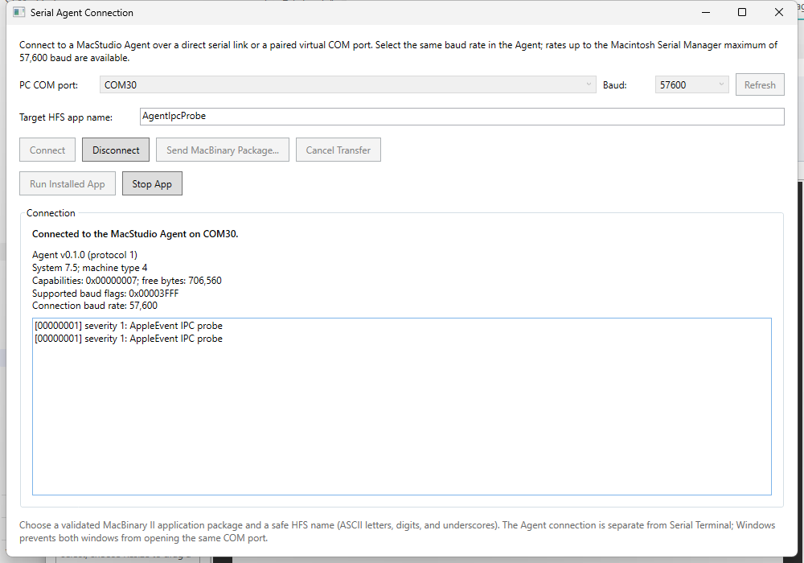
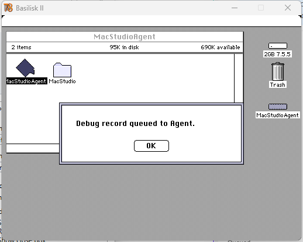

# Serial Agent Build, Installation, and Testing

The MacStudio Serial Agent is a classic 68k background application for
System 7. It opens one Macintosh serial port, negotiates the MSAG v1 protocol,
receives MacBinary II applications over XMODEM-CRC, and can run or request a
quit of the installed application. It also relays bounded debug records from
generated applications to the IDE. The Agent is a separate application: the
IDE's serial connection window does not install or package the Agent itself.

## Support and prerequisites

- Windows 10/11, WSL 2 with Ubuntu, and the Retro68 toolchain built by
  [`scripts/wsl/build-retro68.sh`](../scripts/wsl/build-retro68.sh).
- The Agent sample and HFS bridge included in this repository.
- For emulator tests, a compatible Basilisk II setup, a legally usable System
  disk and ROM, and a pair of connected virtual COM ports. These are external
  assets and are not included.
- For a physical Mac, a suitable Macintosh serial port and an RS-422 adapter
  and cable. See the [connection manual](serial-agent-manual.md); the physical
  wiring and operation have not yet been verified.

The live serial, package transfer, RUN, and debug-record acknowledgement
checks used Basilisk II, System 7.5.5, and paired COM30/COM31 endpoints. System
7.0, physical Macs, generated `MacStudioDebugLog` delivery, and STOP with a
quit-responsive foreground application remain unverified. Do not treat the
emulator results as hardware compatibility certification.

## Build the Agent

From the repository root in PowerShell, build the Retro68 toolchain first if
it is not already available:

```powershell
wsl.exe -d Ubuntu -- bash scripts/wsl/build-retro68.sh
```

Build the Agent and optional test applications. Each command creates a `.dsk`
application image in the specified build directory:

```powershell
wsl.exe -d Ubuntu -- bash scripts/wsl/build-hello-mac.sh `
  feasibility/samples/serial-agent `
  .local-tools/retro68-serial-agent-build `
  MacStudioAgent

wsl.exe -d Ubuntu -- bash scripts/wsl/build-hello-mac.sh `
  feasibility/samples/serial-agent `
  .local-tools/retro68-serial-agent-build `
  AgentIpcProbe

wsl.exe -d Ubuntu -- bash scripts/wsl/build-hello-mac.sh `
  feasibility/samples/serial-agent `
  .local-tools/retro68-serial-agent-build `
  ZAgentLaunchProbe

wsl.exe -d Ubuntu -- bash scripts/wsl/build-hello-mac.sh `
  feasibility/samples/serial-agent `
  .local-tools/retro68-serial-agent-build `
  AgentLaunchTarget
```

The test probes are optional. `AgentIpcProbe` sends a local debug record;
`ZAgentLaunchProbe` asks the Agent to launch `AgentLaunchTarget` from the root
of the same HFS volume.

## First installation on a physical Mac

This is a bootstrap operation; the IDE's PUT workflow can only be used after
the Agent is already installed and running.

1. Build `MacStudioAgent.dsk` as above and export the application from that
   image as a MacBinary II package using the next section.
2. Transfer the `.bin` package to the Mac using a method that preserves the
   MacBinary file intact. On the Mac, use a MacBinary II-compatible expander
   to decode it so both resource and data forks and Finder metadata are
   restored. Do not copy the raw `.bin` file into Startup Items and expect it
   to launch as an application.
3. Place the decoded `MacStudioAgent` application on an HFS volume. To start
   the Agent automatically, add it to that System Folder's `Startup Items`
   folder; otherwise launch it manually after startup. Confirm that the
   Finder shows it as an application.
4. By default, the Agent opens the Modem port at 9600 baud, 8-N-1, with no
   flow control. To select the Printer port or another startup rate, create a
   `MacStudio` folder on the Agent application's volume and add plain ASCII
   `AgentPort` (`MODEM` or `PRINTER`) and/or `AgentBaudRate` (a supported
   numeric rate) files. Restart the Agent after changing the port file.
5. Connect from **Window → Serial Agent Connection** using the same port
   wiring and baud rate. The [connection manual](serial-agent-manual.md)
   covers configuration and serial troubleshooting.

The Agent creates its `MacStudio` storage folder on its application volume if
it does not exist. See the connection manual for exact accepted file contents
and the current hardware-verification caveats.

## Export a MacBinary II package

The HFS bridge uses Retro68's HFS utilities. Run it from the repository root
in WSL after building the application disk:

```bash
mkdir -p .local-tools/serial-agent-packages
bash scripts/wsl/mac-test-bridge.sh export-macbinary \
  .local-tools/retro68-serial-agent-build/MacStudioAgent.dsk \
  MacStudioAgent \
  .local-tools/serial-agent-packages/MacStudioAgent.bin
```

The output is inside the project directory, so it is accessible from Windows
for transfer to a physical Mac or selection in the IDE. Use the same
`export-macbinary` action for a built target application; replace the disk
path, HFS application name, and output package path. The HFS application name
must match the application stored in the disk image.

## Emulator bootstrap

For a disposable System 7 test, `scripts/windows/boot-mac-se.ps1` can install
the Agent in Startup Items before launching Basilisk II. It requires local
System and ROM images, a built Agent disk, an installed Basilisk II executable,
and the HFS bridge. Example values below are placeholders for assets on your
machine; the script accepts Basilisk II only with a Color Classic or
PowerBook 165c target profile:

```powershell
.\scripts\windows\boot-mac-se.ps1 `
  -DiskImagePath .\images\your-system-disk.dsk `
  -RomImagePath .\images\your-rom.ROM `
  -Emulator BasiliskII `
  -TargetProfileId mac-color-classic-68k `
  -GuestScreenWidth 512 `
  -GuestScreenHeight 384 `
  -GuestScreenDepthBits 8 `
  -AppDiskImagePath .\.local-tools\retro68-serial-agent-build\MacStudioAgent.dsk `
  -AppName MacStudioAgent `
  -HfsBridgeScriptPath .\scripts\wsl\mac-test-bridge.sh `
  -AutoStartApplication `
  -AgentBaudRate 57600 `
  -BasiliskSerialA COM30 `
  -BasiliskSerialB COM31
```

The COM names must be distinct Windows endpoints connected as a virtual
null-modem pair. The helper modifies only its disposable System volume and
starts the Agent from Startup Items. Select 57,600 baud in the IDE connection
window to match this example. For a manually configured emulator, start the
Agent from Finder and use the equivalent serial-port mapping. Emulator
results do not verify a physical cable or Mac.

## Deploy and test an application

1. Build the target application and export it from its `.dsk` image as a
   MacBinary II package with the bridge command above. The IDE currently
   accepts a pre-exported package; it does not package the active project.
2. Start the Agent on the Mac and connect it to the host. Open **Window →
   Serial Agent Connection**, select the correct Windows COM endpoint and
   matching baud rate, then connect. A successful handshake displays the
   Agent and guest details.
3. Enter a safe HFS destination name and choose **Send MacBinary Package...**.
   Wait for transfer and installation to finish. Receiving a package does not
   launch it automatically.
4. Choose **Run Installed App** to launch the installed Build ID. The test
   `AgentIpcProbe` can verify local AppleEvent-to-serial debug-record delivery
   and acknowledgement. `ZAgentLaunchProbe` tests Agent-mediated launching
   when `AgentLaunchTarget` is installed at the HFS volume root.
5. **Stop App** sends a quit request. Its behavior with a responsive target
   has not yet been verified; the modal probe test timed out. Treat the result
   as experimental rather than a reliable stop mechanism.

Generated application code also exposes
`OSErr MacStudioDebugLog(unsigned char severity, const char *message)`. Its
end-to-end serial delivery is not yet verified. Protocol details and current
test evidence are in the [protocol reference](serial-agent-protocol.md) and
[sample README](../feasibility/samples/serial-agent/README.md).

## Screenshots

These captures document the verified Basilisk II/System 7.5.5 setup, not
physical Macintosh operation.

### IDE connection and transfer controls



### Agent and probe in the guest

