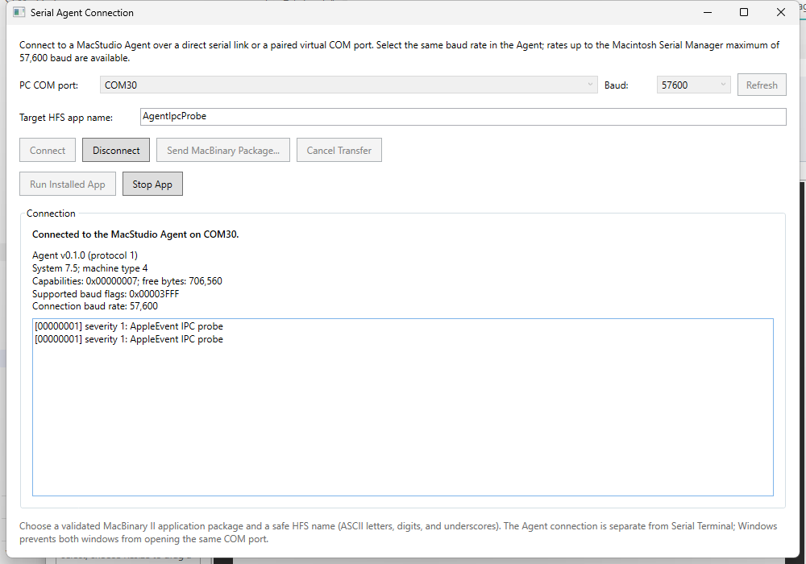
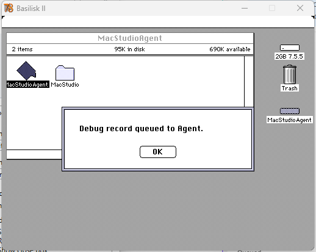

# MacStudio Serial Agent connection manual

This manual explains how to connect a classic Macintosh to the IDE over either
the Modem or Printer serial port, configure the Agent, and verify a serial
session. It covers the MOXA UPort 1130I as a USB-to-RS-422 adapter.

## Support status

The Agent currently supports one selected Macintosh serial port per run:
Modem is the default, and Printer can be selected with the `AgentPort` file
described below. The user can select any classic Serial Manager rate from
300 through 57,600 baud in the IDE and in the Agent's **Baud Rate** menu. Both
ends must use the same rate; 9600 is the default. The connection uses 8 data
bits, no parity, one stop bit (8-N-1), and no flow control.

The Agent handshake, package transfer, RUN command, and debug-record
acknowledgement were exercised with Basilisk II, System 7.5.5, and a virtual
null-modem pair on COM30/COM31, including a 5,888-byte package at 57,600 baud.
The STOP command timed out while the probe application displayed a modal
dialog, so STOP behavior is not yet verified. The physical MOXA cable drawing
below is a signal-level wiring reference, not a report of a completed real-Mac
test.
Before building or connecting a cable, verify the connector gender, RS-422
mode, signal names, and DB9 pin numbers against the documentation supplied for
the exact UPort 1130I hardware revision. System 7.0 and physical Macintosh
validation remain pending.

## What you need

- A Macintosh with a working 8-pin Mini-DIN serial port. A Macintosh SE has a
  Modem port and a Printer port; both use the same RS-422 Mini-DIN-8 signal
  assignment.
- A MOXA UPort 1130I configured for four-wire, full-duplex RS-422. Do not
  configure it for RS-232 or two-wire RS-485.
- A USB connection from the UPort to the Windows IDE host and the appropriate
  MOXA Windows driver. In Windows, identify the COM port assigned to the
  adapter in Device Manager.
- A correctly wired Mini-DIN-8-to-DB9 cable. The Mac end must mate with the
  selected Mac port; the DB9 end must mate with the UPort connector. Do not
  infer signal assignments from wire colors.
- The MacStudio Agent installed on an HFS volume and configured to open the
  chosen Mac port.

Do not connect a PC RS-232 port directly to a Macintosh Mini-DIN-8 serial
port. RS-232 and Macintosh RS-422 use different electrical signaling. The
UPort 1130I is useful here because it provides an RS-422 interface; check the
isolation and electrical specifications in the current MOXA manual before
connecting it to equipment.

## Macintosh SE port selection

Both SE serial ports use the same connector pinout. Their names describe the
classic Mac serial drivers:

| Port | Serial Manager input driver | Serial Manager output driver | Typical use |
|---|---|---|---|
| Modem | `.AIn` | `.AOut` | Modem port; the Agent default |
| Printer | `.BIn` | `.BOut` | Printer port |

Only one port is opened by an Agent process. This avoids reserving both ports
and lets other software use the unselected port. Connect the cable to the port
selected by the Agent. If the Agent and cable disagree, the PC will not receive
a HELLO response.

### Select Modem

If `MacStudio/AgentPort` does not exist on the Agent's HFS volume, the Agent
opens the Modem port. The file may also explicitly contain `MODEM`.

### Select Printer

Create a plain ASCII text file named exactly `AgentPort` inside the `MacStudio`
folder at the root of the Agent's HFS volume. Its contents must be the single
word `PRINTER`. A trailing carriage return or line feed is accepted, as are
leading/trailing spaces and lowercase letters. Do not include a UTF-8 byte
order mark, extra words, or a filename extension. Restart the Agent after
changing this file.

If the file contains any other value or is unreadable, the Agent does not
start its serial service. Delete the file to restore the default Modem port.
The host currently cannot query which physical Mac port the Agent selected;
record the selected port with the target setup.

### Select the Agent baud rate

The Agent's **Baud Rate** menu contains all supported classic Serial Manager
rates up to `baud57600` (57,600 baud). Select a rate before connecting, or
select it while the Agent is running; the checkmark shows the active rate. A
selection reopens the serial drivers and saves the choice to the `MacStudio`
folder on the Agent application's HFS volume. If a host is already connected,
disconnect it first and reconnect after selecting the new rate.

To configure the startup rate without using the menu, create a plain ASCII file
named exactly `AgentBaudRate` inside the `MacStudio` folder at the root of the
Agent application's HFS volume. Set its contents to one supported numeric
rate:

`300`, `600`, `1200`, `1800`, `2400`, `3600`, `4800`, `7200`, `9600`,
`14400`, `19200`, `28800`, `38400`, or `57600`.

Whitespace around the number and one trailing line ending are accepted. Do not
include a byte-order mark, extra text, or a filename extension. If the file is
absent, the Agent defaults to 9600. An invalid or unreadable file prevents
the serial service from starting. The menu applies a selected rate immediately
and writes the choice back to this file.

For an emulator test using `scripts/windows/boot-mac-se.ps1`, pass
`-AgentBaudRate 57600` together with `-AutoStartApplication` and
`-AppName MacStudioAgent`. The boot helper writes this setting to the
disposable System 7 volume and starts the Agent copy from that same volume, so
the Agent reads the setting on startup.

In **Window → Serial Agent Connection**, select the same baud rate before
connecting. The IDE displays the Agent's supported-rate flags after HELLO.
If the selected rate is not supported by the Agent, the IDE rejects the
connection. A rate mismatch usually prevents HELLO entirely, so start at
9600, confirm both settings, then increase the rate on both ends together.

## Connector signal reference

The Mac Mini-DIN-8 pin assignments used by the classic serial ports are:

| Mac pin | Signal | Direction at the Mac |
|---:|---|---|
| 1 | HSKo, handshake output | Output |
| 2 | HSKi, handshake input | Input |
| 3 | TxD- | Output |
| 4 | Signal ground | Common |
| 5 | RxD- | Input |
| 6 | TxD+ | Output |
| 7 | GPi, general-purpose input | Input |
| 8 | RxD+ | Input |

For four-wire RS-422, cross the transmit and receive pairs and preserve
polarity. The following table maps the Mac signals to the UPort 1130I DB9
signals. The UPort pin numbers shown are the common UPort 1100-series
RS-422 assignment; confirm them against the exact UPort 1130I manual before
terminating a cable.

| Macintosh SE Mini-DIN-8 | Signal | MOXA UPort 1130I DB9 | Signal |
|---:|---|---:|---|
| 6 | TxD+ | 3 | RxD+ |
| 3 | TxD- | 4 | RxD- |
| 8 | RxD+ | 2 | TxD+ |
| 5 | RxD- | 1 | TxD- |
| 4 | Signal ground | 5 | Signal ground |
| 1, 2, 7 | Handshake / GPi | Not connected | No flow control |

```text
Macintosh SE                                         MOXA UPort 1130I
Mini-DIN-8 port                                      DB9 RS-422 port

Mac TxD+  pin 6  ----------------------------------> RxD+  pin 3
Mac TxD-  pin 3  ----------------------------------> RxD-  pin 4
Mac RxD+  pin 8  <---------------------------------- TxD+  pin 2
Mac RxD-  pin 5  <---------------------------------- TxD-  pin 1
Mac GND   pin 4  ----------------------------------- GND   pin 5

Mac pins 1 (HSKo), 2 (HSKi), and 7 (GPi): not connected
```

The diagram is by signal and pin number; it is not a view of either connector's
mating face. Do not use a physical connector drawing without confirming
whether it shows the plug or socket side. If the actual UPort documentation
shows different DB9 assignments for the adapter revision in hand, use that
documentation and update the cable mapping before connecting power.

### Cable and electrical checks

1. Disconnect the adapter from USB and the cable from the Mac before changing
   wiring.
2. Verify the UPort is in RS-422 four-wire mode and the selected COM port is
   the UPort adapter.
3. Check each cable conductor end-to-end with a continuity tester. Check for
   shorts between the differential pairs and ground.
4. Confirm the two differential pairs are crossed as shown: Mac Tx goes to
   UPort Rx, and UPort Tx goes to Mac Rx. Keep `+` connected to `+` and `-`
   connected to `-`; do not swap a pair's polarity.
5. Leave hardware handshaking disconnected. The Agent configures no flow
   control, so RTS/CTS or Mac handshake wires must not be required for this
   connection.
6. Do not add a termination resistor based only on this drawing. Follow the
   MOXA manual and the cable-length/topology requirements for the actual
   installation. This is a point-to-point connection, not a multidrop bus.

If the cable is custom-built, label both ends with port and signal names. A
generic RS-232 null-modem cable is not a substitute for this RS-422 cable.

## Windows host setup

1. Install the MOXA UPort driver for the Windows version in use and connect
   the UPort to USB.
2. Open Device Manager and note the assigned COM number. The IDE enumerates
   serial ports in **Window → Serial Agent Connection**; use **Refresh** after
   connecting the adapter.
3. Close any other program that may have the COM port open. Windows generally
   grants an exclusive open, so the IDE and a terminal application cannot
   use the same COM port simultaneously.
4. Connect the cable to the selected Macintosh port and the UPort DB9
   connector.
5. In **Window → Serial Agent Connection**, select the MOXA COM port and the
   same baud rate configured in `MacStudio/AgentBaudRate`, then connect. Both
   ends use 8-N-1 with no flow control.
6. A successful connection shows the Agent version, System version, machine
   type, capabilities, target free space, and supported baud-rate flags.
7. To send a package, enter a valid HFS application name and choose **Send
   MacBinary Package...**. The host sends a pre-exported MacBinary II package;
   the current UI does not yet package the active project.
8. Use **Run Installed App** to launch the last package sent in the current
   IDE connection, or **Stop App** to request that it quit. The IDE tracks the
   Build ID for the connection; reconnecting does not restore that selection.
   A successful stop response means the Agent accepted the quit AppleEvent,
   not necessarily that the application has already exited.
9. Generated form code provides
   `OSErr MacStudioDebugLog(unsigned char severity, const char *message)`.
   Call it from the application to send a printable-ASCII message of at most
   512 bytes to the IDE. It reports an error if the Agent is unavailable or
   its one-record queue is occupied. Logs are sent once, without retry or
   durable buffering.

## Basilisk II and virtual COM pairs

For an emulator test on Windows, use a virtual null-modem pair. The IDE opens
one endpoint and Basilisk II opens its paired endpoint. The two endpoints must
be different COM ports from the same pair.

- With com0com, use the two ports it creates as the IDE and Basilisk endpoints.
- If com0com is unsupported on the Windows version in use, Eterlogic Virtual
  Serial Ports Emulator (VSPE) is another option; check its current Windows
  support and licensing.
- In the IDE's emulator settings, Serial A maps to the Mac Modem port and
  Serial B maps to the Mac Printer port. The Agent's `AgentPort` setting must
  agree with the emulator port connected to the virtual pair.
- Configure the virtual pair at the selected baud rate, 8-N-1, with no flow
  control. The IDE, Agent, and Basilisk II endpoint must agree. Restart
  Basilisk II after changing its serial endpoint.

The recorded live test used IDE COM30 and Basilisk II COM31 with Serial A
(Modem), System 7.5.5, and a null-modem pair. It verified host-to-Agent and
Agent-to-host protocol traffic and package transfers. It did not test a
physical UPort, a physical Mac, or System 7.0.

## Live session screenshots

These are direct captures of the Basilisk II/System 7.5.5 test using IDE COM30,
Basilisk II Serial A on COM31, and 57,600 baud. The host capture shows the
successful handshake, installed package identity, and the probe's debug record.
The two sequence-1 log entries are from separate Agent process runs; sequence
numbers restart when the Agent is launched.



The guest's confirmation dialog appears after the probe queues its local
AppleEvent; the host log above confirms that the Agent relayed the record and
received its acknowledgement.



## Two-way communication check

Before attempting a package transfer:

1. Verify the Agent is running as a background application. When used as a
   Startup Item, confirm it is on the target's startup disk and has launched.
2. Confirm the cable is connected to the port selected by `AgentPort`.
3. Connect from the IDE. A completed HELLO/HELLO_ACK handshake confirms
   host-to-Mac requests and Mac-to-host responses at the protocol level.
4. If testing only basic text transport, use **Window → Serial Terminal** with
   a guest terminal/responder instead. The terminal and Agent connection are
   separate windows and must not open the same Windows COM port at once.
5. After a successful Agent connection, send a small, known-good MacBinary
   package first. Confirm the completion result and installed app on the Mac
   before sending a larger application.

The Agent owns the selected Mac serial port while it runs. The BUT must not
open or reset that same serial driver; application diagnostics are relayed
through the Agent's AppleEvent interface instead.

## Troubleshooting

| Symptom | Checks |
|---|---|
| No PC COM port in the IDE | Confirm the MOXA driver loaded, reconnect USB, then select **Refresh**. |
| COM port is busy | Close the IDE Serial Terminal, another IDE instance, or other serial monitor using that COM port. |
| No HELLO response | Verify the Agent is running; confirm Modem/Printer selection; confirm the Basilisk A/B mapping; check TX/RX crossover, pair polarity, ground, COM selection, and matching 8-N-1 settings. Start at 9600 baud, then confirm the selected rate in both the IDE and Agent configuration. |
| One-way traffic only | Check both differential pairs independently. Mac Tx must land on UPort Rx and UPort Tx on Mac Rx. |
| Unstable or corrupted frames | Verify RS-422 mode (not RS-232 or 2-wire RS-485), polarity, grounding, cable quality, and no unwanted flow-control wiring. |
| Agent does not start after selecting Printer | Remove or correct `MacStudio/AgentPort`; only `MODEM` and `PRINTER` are accepted. Restart the Agent. |
| Package rejected | Verify the package is MacBinary II for an `APPL` application, the HFS destination name is safe, and the target has sufficient free space. |
| Transfer stalls | Check cable integrity, the selected Agent port, flow-control settings, and whether either endpoint reset or closed its serial driver. Cancel from the IDE before closing the connection window. |

Do not repeatedly retry a physical connection if the adapter becomes hot, the
Mac resets, or the serial interface behaves abnormally. Disconnect it and
recheck the exact adapter datasheet and cable wiring first.

## Current limitations

- Real Macintosh and MOXA UPort 1130I electrical compatibility have not been
  physically tested.
- System 7.0 has not been validated; emulator evidence is for System 7.5.5.
- The Agent is a prototype with no installer or UI-based port selector. Its
  Baud Rate menu changes and saves the rate; the `AgentPort` file still selects
  Modem or Printer at startup. It also has no automatic active-project
  packaging or reliable/retried debug delivery.
- RUN and the probe's debug-record relay/acknowledgement were verified at
  57,600 baud in Basilisk II. STOP timed out while the probe's modal dialog was
  open and must be retested with a quit-responsive target. The generated
  `MacStudioDebugLog` API has not been verified end-to-end. Receiving a file
  does not automatically launch it.
- Only one selected port and one active Agent session are supported.
- Modem is the default when `AgentPort` is absent. The selected port is not
  reported in HELLO_ACK.

## Reference documents

- MOXA, **UPort 1100 Series User's Manual**, sections on RS-422/RS-485 mode,
  DB9 pin assignments, electrical specifications, and driver configuration.
  Obtain the manual for the exact UPort 1130I model and hardware revision from
  [MOXA Support](https://www.moxa.com/en/support).
- Apple **Inside Macintosh: Serial Communications** and the Macintosh SE
  hardware/service documentation for the Mini-DIN-8 serial signals and
  Serial Manager driver names.
- The repository's [wire protocol specification](serial-agent-protocol.md)
  and [Agent sample guide](../feasibility/samples/serial-agent/README.md).
