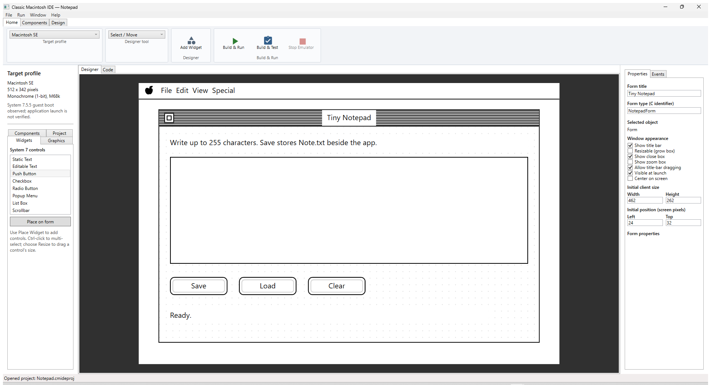
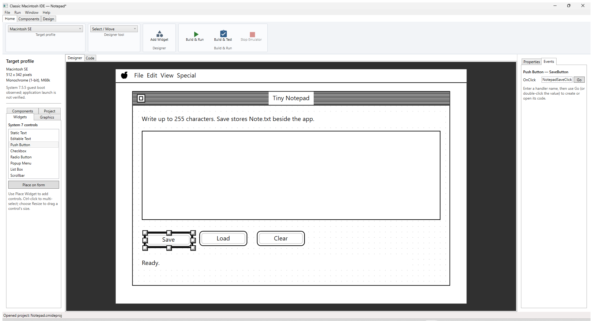
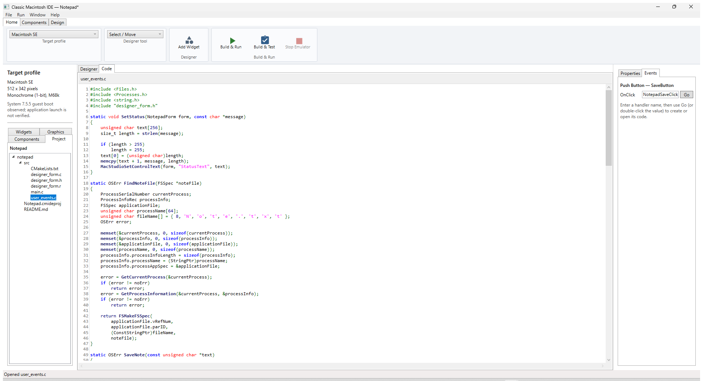
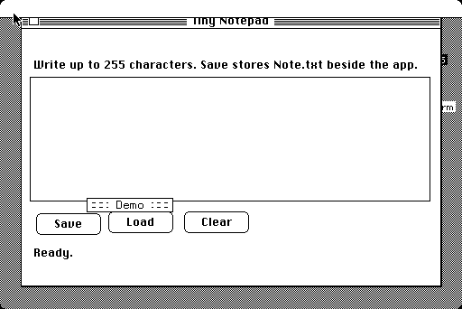
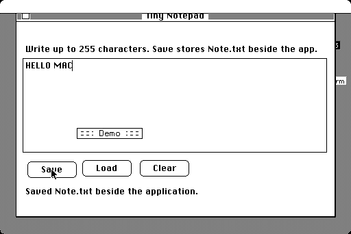
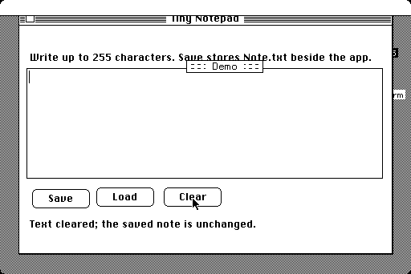
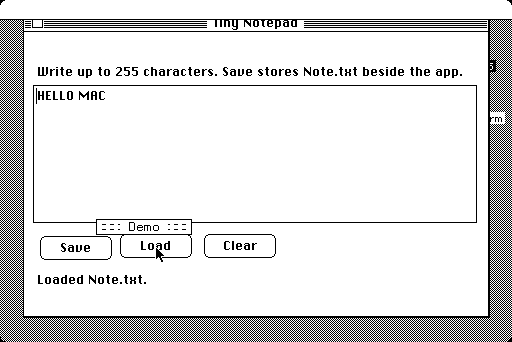

# Classic Mac for Dummies 1: How to program a Notepad Application

This guide builds a small System 7 notepad using the visual designer and C.
You draw the interface in the IDE, bind buttons to C functions, then build and
run the application in a Macintosh emulator.

The finished project is [Notepad.cmideproj](../samples/notepad/Notepad.cmideproj);
its editable C sources are in
[src](../samples/notepad/src/). The target is a 512 × 342,
one-bit Macintosh SE. The text control and file format are limited to 255
bytes, matching classic Pascal strings.

## 1. Start a project

1. Start ClassicMacStudio.
2. Select **File → New Project...** and save a working copy as
   `Notepad.cmideproj`. Keep the checked-in sample unchanged if you are
   following along.
3. In the **Target profile** selector, choose **Macintosh SE**. The profile
   shows the screen resolution and one-bit monochrome mode on the left.
4. In the Properties inspector, set the form title to `Tiny Notepad`. Keep
   the title bar on and set the initial position to left `24`, top `32`, with
   **Center on screen** turned off. This keeps the test marker inside the
   predictable Mac SE window bounds.
5. Save with **File → Save Project**.

The form uses target pixels, not Windows display pixels. A control at `(12,36)`
means 12 pixels from the left and 36 pixels below the form's content origin.

## 2. Draw the notepad form

Choose **Widgets** in the left Toolbox / Project Explorer pane. Select a widget,
click **Place on form**, then position it on the canvas. Select a placed widget
to edit its stable ID, text, and bounds in **Properties / Events** on the
right. Keep every control within the form; the sample leaves room for the
title bar on the small Mac SE display.

Add these controls:

| Widget | Stable ID | Display text | Suggested position (x, y, w, h) |
|---|---|---|---|
| Static Text | `Instructions` | `Write up to 255 characters. Save stores Note.txt beside the app.` | 12, 12, 438, 16 |
| Editable Text | `NoteText` | *(empty)* | 12, 36, 438, 132 |
| Push Button | `SaveButton` | `Save` | 12, 182, 72, 24 |
| Push Button | `LoadButton` | `Load` | 96, 182, 72, 24 |
| Push Button | `ClearButton` | `Clear` | 180, 182, 72, 24 |
| Static Text | `StatusText` | `Ready.` | 12, 220, 390, 20 |

Stable IDs are for code and event bindings; the visible button caption can be
changed without changing the C function name. Save the project after arranging
the controls.



## 3. Connect the buttons to C events

For each button:

1. Select the button on the canvas.
2. Open **Events** in the right inspector.
3. Set **OnClick** to the function shown below. Use a valid C identifier.
4. Repeat for the other buttons, then save the project.

| Control | OnClick handler |
|---|---|
| `SaveButton` | `NotepadSaveClick` |
| `LoadButton` | `NotepadLoadClick` |
| `ClearButton` | `NotepadClearClick` |

The project generator writes the corresponding declarations to
`designer_form.h`. Keep your implementation in `user_events.c`; generated
files such as `designer_form.c` are recreated when you build.



## 4. Write the application code

Open the Project tab on the left and double-click `src/main.c`. The entry
point starts the generated form; the IDE calls the form-load hook after
initializing controls.

```c
#include "designer_form.h"

int main(void)
{
    return MacStudioRunForm();
}

void MacStudioFormDidLoad(NotepadForm form)
{
    (void)form;
}
```

Open `src/user_events.c` and implement the three handlers. `form` is the
generated dialog handle; `item` is the Dialog Manager item number. Prefer
stable control IDs such as `"NoteText"` over hard-coded item numbers.

The sample's Save handler retrieves the editable field as a Pascal string, then
uses the File Manager to open `Note.txt` in the same HFS folder as the running
application:

```c
unsigned char text[256];
OSErr error = MacStudioGetControlText(form, "NoteText", text);
if (error == noErr)
    error = SaveNote(text);

SetStatus(form, error == noErr
    ? "Saved Note.txt beside the application."
    : "Save failed; check the disk and note length.");
```

`SaveNote` finds the app's `FSSpec` with `GetProcessInformation`, creates
`Note.txt` if needed, truncates the old file, and writes the text bytes without
the Pascal length byte. Load reads at most 255 bytes and updates the field.
Clear empties only the field; it deliberately does not delete the saved note.
All three complete handlers are in the finished project's
[user_events.c](../samples/notepad/src/user_events.c).



Classic TextEdit strings store their length in byte zero, followed by the
characters. Keep the 255-byte limit in mind; do not assume a modern
null-terminated or Unicode string. The sample reports file errors in
`StatusText` instead of silently claiming the save succeeded.

## 5. Build and run

1. Save all project and C files.
2. Select **Run → Mini vMac (Mac SE)**.
3. Choose **Build & Test**. The IDE generates the form resources, builds the
   68k application with Retro68, launches a disposable System 7.5.5 guest, and
   checks form metadata and dispatches each interactive widget.
4. Choose **Build & Run** for an interactive session. Type a short note, click
   **Save**, click **Clear**, then **Load**. The text should return and the
   status should say `Loaded Note.txt.`.

The generated application disk is written under the project `.build` folder.
The IDE currently names its generated executable `DesignerForm`; the form
window title remains `Tiny Notepad`.



The following captures show a real Mini vMac run: the sample saved `HELLO MAC`,
cleared the field, then loaded the same text from `Note.txt`.







The moving `Demo` label in guest screenshots is Mini vMac's free-variation
overlay, not part of the application.

## 6. Write useful tests

The IDE's generated Build & Test verifies that controls exist at the expected
bounds and that bound click handlers are reached. It does not assert every
application-specific message or file byte. Add these explicit checks when
testing the finished app:

The interactive Mini vMac run verified save, clear, and reload in one session.
Quitting and relaunching, boundary-length, missing-file, and disk-error cases
remain useful additional tests.

| Case | Action | Expected result |
|---|---|---|
| Save and reload | Enter `hello`, Save, Clear, Load | Field contains `hello`; status reports loaded |
| Persistence | Save, quit, launch again, Load | The same note is restored |
| Overwrite | Save `first`, replace it with `second`, Save, Load | Only `second` is loaded |
| Empty file | Clear, Save, Load | Field remains empty; no stale bytes reappear |
| Length boundary | Save and reload 255 printable bytes | All 255 bytes are preserved |
| Missing file | Remove `Note.txt`, then Load | A clear “not saved yet” message appears |
| Disk error | Try a read-only or full test volume | Save reports failure and does not claim success |

Repeat the tests after changing file handling or event bindings. Use short
ASCII/MacRoman-compatible text for this beginner sample; the field is not a
Unicode editor.

## 7. Test on a real Macintosh

This project is designed for the Mac SE's monochrome 512 × 342 display, but
physical hardware compatibility has not been certified.

1. Back up the target HFS disk and confirm the Mac boots System 7.
2. Build the application in the IDE. If the Mac runs System 7.5.5 and has the
   MacStudio Agent installed, export the app disk as MacBinary II:

   ```powershell
   wsl.exe --distribution Ubuntu -- bash -lc 'cd /mnt/e/own/MacStudio && scripts/wsl/mac-test-bridge.sh export-macbinary feasibility/samples/notepad/.build/DesignerForm.dsk DesignerForm feasibility/samples/notepad/.build/Notepad.bin'
   ```

3. In **Window → Serial Agent Connection**, connect at the same baud rate as
   the Agent, choose **Send MacBinary Package...**, and transfer the generated
   `Notepad.bin`. See the [Serial Agent connection
   manual](../serial-agent-manual.md) before wiring a physical serial link.
4. On the Mac, launch the transferred app. Save a note, quit, relaunch, and
   load it. Confirm `Note.txt` is created beside the application on the HFS
   volume.

The Agent transfer procedure is documented and emulator-tested, but the
physical Mac/MOXA connection is not yet verified. The Agent's System 7.0
behavior is also pending; for that OS version, use a known-good HFS transfer
method and treat the run as experimental.
