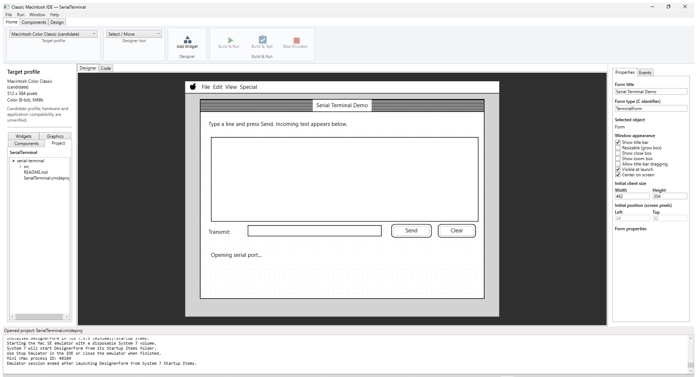
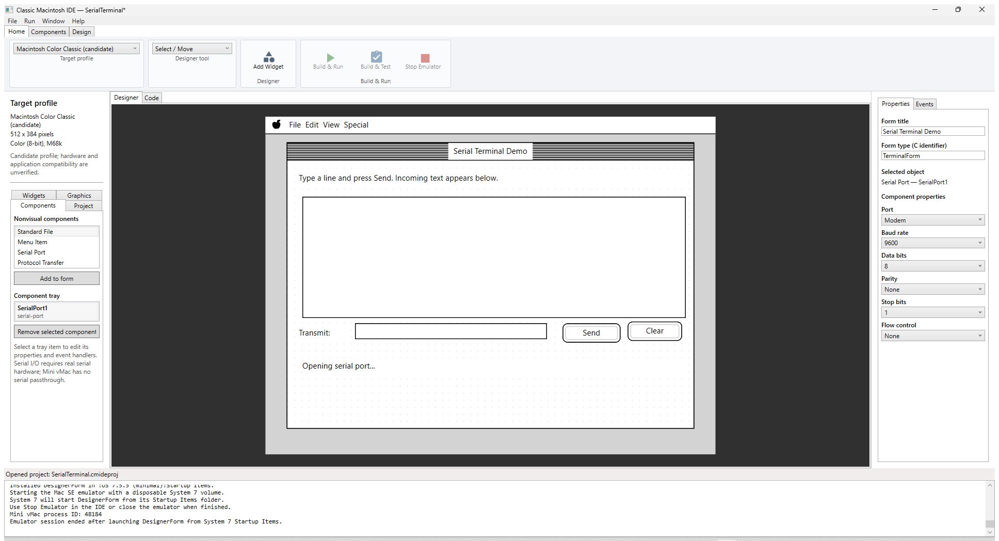
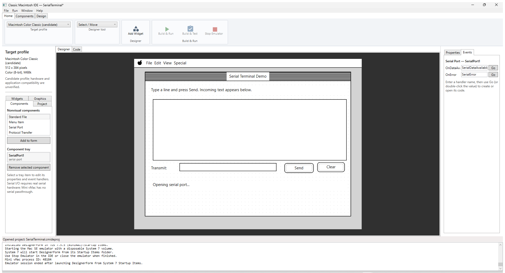
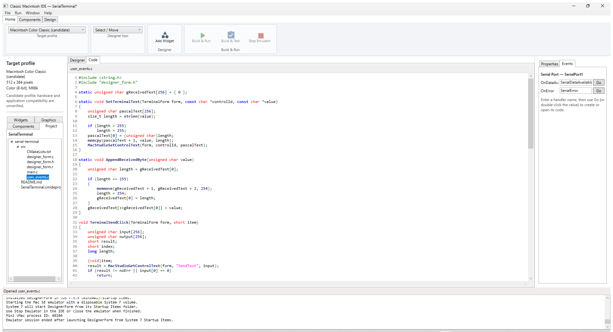
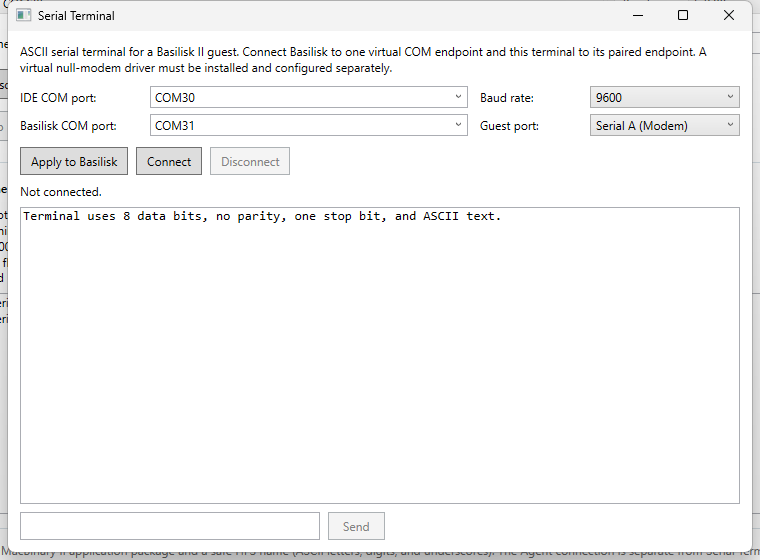

# Classic Mac for Dummies 2: How to create a serial Terminal Program

This guide builds a simple ASCII terminal for the Macintosh Modem port. The
Mac app sends a line when you click **Send**, receives printable characters
from the serial driver, and displays them in an editable text area. A separate
terminal window in the Windows IDE is the other end of the connection.

The finished project is
[SerialTerminal.cmideproj](../samples/serial-terminal/SerialTerminal.cmideproj).
Its source code is in
[src/main.c](../samples/serial-terminal/src/main.c) and
[src/user_events.c](../samples/serial-terminal/src/user_events.c). The project
uses the 512 × 384 color Macintosh Color Classic profile (a candidate profile,
not a claim of exact hardware certification).

## 1. Create the visual project

1. Start ClassicMacStudio and select **File → New Project...**.
2. Save your working copy as `SerialTerminal.cmideproj`.
3. Select **Macintosh Color Classic** in the target profile selector. The
   design surface is 512 × 384 pixels and 8-bit color.
4. Set the form title to `Serial Terminal Demo`.
5. Add these controls from the **Widgets** palette. Use **Place on form**, then
   drag and resize each control. Select it to edit its stable ID and text.

| Widget | Stable ID | Text | Position (x, y, w, h) |
|---|---|---|---|
| Static Text | `Instructions` | `Type a line and press Send. Incoming text appears below.` | 12, 12, 438, 16 |
| Editable Text | `ReceivedText` | *(empty)* | 16, 40, 438, 140 |
| Static Text | `InputLabel` | `Transmit:` | 12, 188, 58, 16 |
| Editable Text | `SendText` | *(empty)* | 76, 184, 220, 20 |
| Push Button | `SendButton` | `Send` | 310, 182, 68, 24 |
| Push Button | `ClearButton` | `Clear` | 386, 182, 64, 24 |
| Static Text | `ConnectionStatus` | `Opening serial port...` | 16, 224, 438, 20 |



## 2. Add the serial component

Serial I/O is nonvisual: add it to the component tray, not to the form canvas.

1. Select the **Components** tab in the left palette.
2. Select **Serial Port**, then click **Add to form**.
3. Select the new component in the tray. In the inspector set:
   - ID: `SerialPort1`
   - Port: `Modem`
   - Baud: `9600`
   - Data bits: `8`
   - Parity: `None`
   - Stop bits: `1`
   - Flow control: `None`
4. Bind the component's `OnDataAvailable` event to `SerialDataAvailable` and
   `OnError` to `SerialError`.
5. Bind `SendButton.OnClick` to `TerminalSendClick` and
   `ClearButton.OnClick` to `TerminalClearClick`.
6. Save the project.





Both ends must use the same baud rate and 8-N-1 framing. The sample starts at
9600 baud; if you change it in the component, also change the Windows terminal
rate.

## 3. Understand the C event handlers

`main.c` starts the form. When the form is loaded, `MacStudioFormDidLoad`
opens the serial component and shows either a ready message or the returned
Mac OS error number.

The Send handler reads a Pascal string from `SendText`, copies its characters
into a byte buffer, appends a carriage return if needed, and writes the bytes:

```c
length = input[0];
for (index = 0; index < input[0]; index++)
    output[index] = input[index + 1];
if (output[length - 1] != '\r' && length < 255)
    output[length++] = '\r';
result = MacStudioSerialWrite("SerialPort1", output, length);
```

On success it clears the input field and changes the status. On failure it
keeps the problem visible. `SerialDataAvailable` reads bytes from the same
component, displays CR/LF as a new line, handles backspace, and ignores
non-printable bytes. Its display buffer is also a 255-byte Pascal string, so
new incoming characters replace the oldest ones when the buffer fills.

The app's port-open, send, receive, and error handlers are in the finished
project's `src` folder. Keep user code in `main.c` and `user_events.c`; the
IDE regenerates `designer_form.c`, `.h`, `.r`, and `CMakeLists.txt`.



## 4. Run and test the serial link in Basilisk II

Mini vMac does not provide serial-device passthrough. Use Basilisk II and a
virtual null-modem pair or suitable physical serial hardware.

1. Install and configure a virtual serial pair, for example COM30/COM31 using
   [com0com](https://com0com.sourceforge.net/) or
   [VSPE](https://eterlogic.com/Products.VSPE_Download.html). The IDE and
   Basilisk II must use opposite endpoints of the same pair.
2. Stop or disconnect the Serial Agent if it is using this COM pair. Do not
   connect two host windows to the same COM port.
3. In the IDE choose **Window → Serial Terminal**.
4. Select the host endpoint for **IDE COM port** and the paired endpoint for
   **Basilisk COM port**. Set **Guest port** to **Serial A (Modem)** and set
   the **Baud rate** to `9600`.
5. Click **Apply to Basilisk**, then **Connect** in the host terminal.
6. Select **Run → Basilisk II (Color Classic / PowerBook)**, then use
   **Build & Run**. The app should show `Modem ready - waiting for input.`
7. Type `HELLO FROM WINDOWS` in the IDE terminal and send it. It should appear
   in the Mac app's receive field. Type a line in the Mac app and click
   **Send**; it should appear in the Windows terminal.



This is a configuration-only screenshot; its status is **Not connected**.
The sample built successfully with the Retro68 68k toolchain, but its guest
and host were not connected during this tutorial run. The current Agent
session already owns COM30/COM31 at 57,600 baud, so it was left undisturbed.
The [earlier serial-terminal test](../../docs/developerManual.md#ide-serial-terminal-and-demo-project)
verified traffic in both directions at 9600 baud, 8-N-1, and repeated the
test after restarting Basilisk II. This screenshot is not evidence of that
earlier connected run.

For a real virtual pair, use its actual COM numbers instead of COM30/COM31.
Close any other app that has the selected guest port open. An `Open failed`
message means the Macintosh serial driver could not be opened; check for a
conflicting Agent/app, wrong guest port, or unsupported emulator setting.

## 5. Test the behavior deliberately

The Color Classic profile supports **Build & Run**, but the IDE's automated
**Build & Test** is limited to Mini vMac and the Mac SE profile. Use these
manual integration cases for the serial data path after freeing a COM pair.
The first two cases were verified in the earlier COM30/COM31 test; the
remaining edge cases are recommended regression checks and were not all run:

| Case | Action | Expected result |
|---|---|---|
| Host to guest | Send `HELLO` from the IDE terminal | `HELLO` appears in `ReceivedText` |
| Guest to host | Enter `WORLD` and click **Send** | Host receives `WORLD` followed by a line break |
| Empty send | Click **Send** with an empty field | No bytes are sent |
| Clear | Receive text, click **Clear** | Receive display clears; serial port remains open |
| Newline | Send CR, LF, and CR/LF from the other end | Each line break is displayed as a new line |
| Backspace | Send printable text followed by backspace | The last displayed character is removed |
| Long input | Send more than 255 printable bytes | The display retains the most recent 255 bytes |
| Disconnect/error | Close the paired endpoint during a run | The app reports an I/O error instead of claiming success |

Good serial tests exercise both directions, framing, buffer boundaries, and
failure behavior. For repeatability, record the emulator, COM endpoints,
baud, framing, and exact test strings.

## 6. Test with a real Macintosh

Use the Mac's Modem port and a USB-to-RS-422 adapter such as a correctly
configured MOXA UPort 1130I. **Do not connect a PC RS-232 port directly to the
Mac's RS-422 Mini-DIN-8 port.** Read the
[Serial Agent connection manual](../../docs/serial-agent-manual.md) for connector
signals, safe wiring, and the MOXA pinout reference before making a cable.

1. Build the app in the IDE and transfer it to a backed-up HFS volume using a
   known-good method.
2. On the Mac, run the terminal app and confirm that it opens the selected
   serial port.
3. In **Window → Serial Terminal**, select the MOXA COM port, set the same
   baud (start at 9600), and connect.
4. Send short lines in both directions. Then repeat at another mutually
   supported baud rate after changing both the app component and host terminal.
5. If the Agent is running on that same serial port, stop it before launching
   this app; the two applications cannot own the port simultaneously.

The sample's bidirectional path was verified in Basilisk II, but physical
MOXA-to-Mac communication remains unverified. Record any future hardware
result separately from emulator results.
