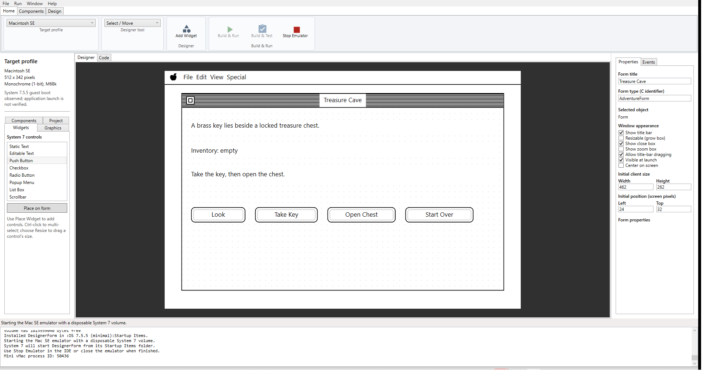
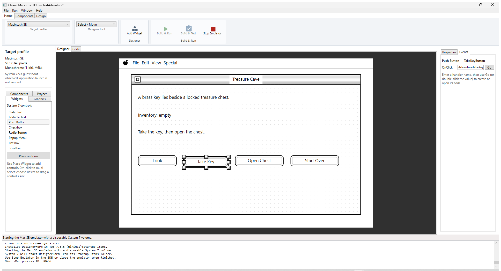
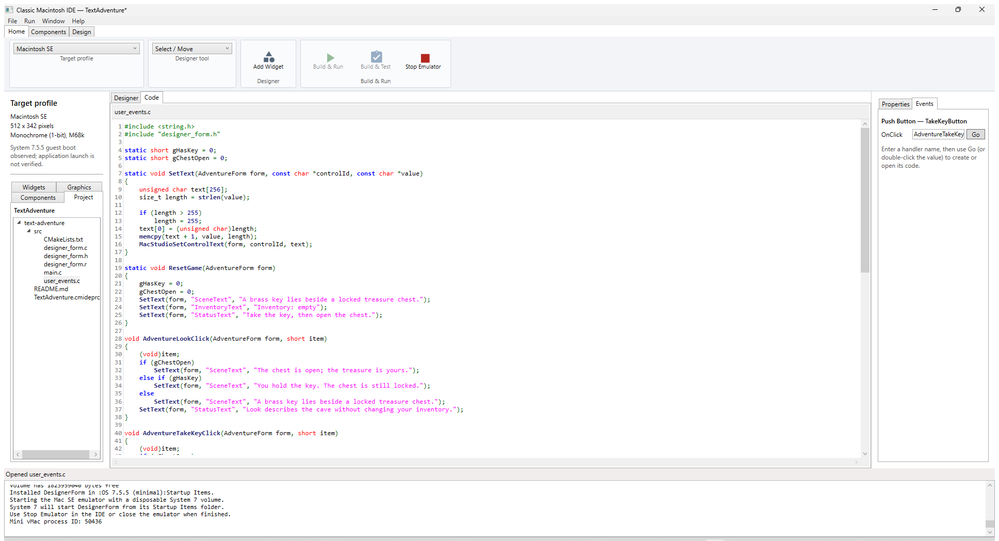
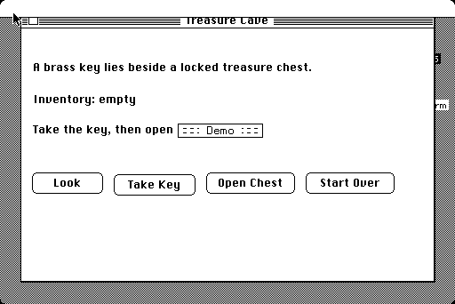
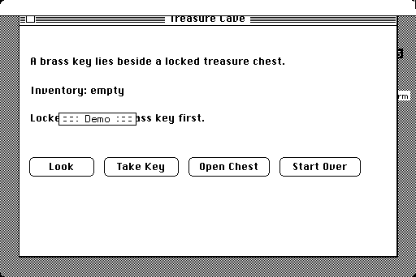
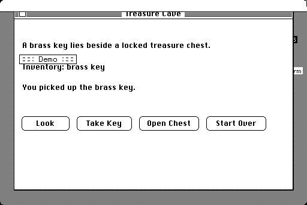
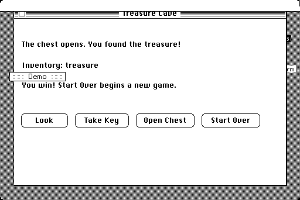
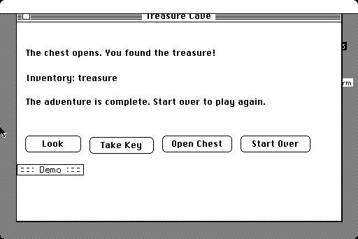
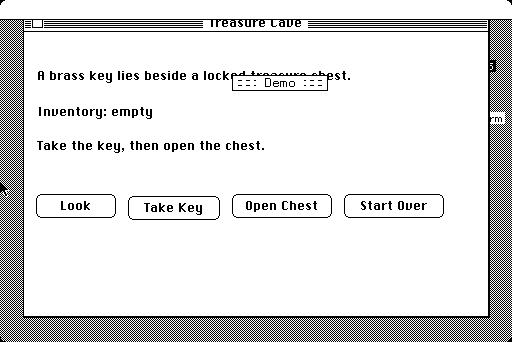

# Classic Mac for Dummies 3: How to create a Text-Based Game

This guide makes a small, deterministic adventure called **Treasure Cave**.
There are no graphics or random choices: the player looks around, takes a
brass key, opens a chest, and can restart. The goal is to learn how visual
controls, event bindings, and simple application state fit together.

The finished Macintosh SE project is
[TextAdventure.cmideproj](../samples/text-adventure/TextAdventure.cmideproj),
with C code in [src/user_events.c](../samples/text-adventure/src/user_events.c).
It targets a 512 × 342 one-bit display and keeps all text short enough for the
classic controls.

## 1. Create a monochrome project

1. Start ClassicMacStudio and choose **File → New Project...**.
2. Save a working copy as `TextAdventure.cmideproj`.
3. Choose **Macintosh SE** in the target profile selector.
4. Set the form title to `Treasure Cave`. Set **Center on screen** off and the
   initial position to left `24`, top `32`; keep the form within the 512 × 342
   target display.
5. Save the project.

## 2. Draw the story and action buttons

In the left **Widgets** palette, select a widget and click **Place on form**.
Select each placed control to set its ID, caption, and pixel bounds in the
right inspector. Use static text for the scene, inventory, and status; use
buttons for player actions.

| Widget | Stable ID | Initial text | Position (x, y, w, h) |
|---|---|---|---|
| Static Text | `SceneText` | `A brass key lies beside a locked treasure chest.` | 12, 16, 438, 20 |
| Static Text | `InventoryText` | `Inventory: empty` | 12, 52, 438, 20 |
| Static Text | `StatusText` | `Take the key, then open the chest.` | 12, 86, 438, 20 |
| Push Button | `LookButton` | `Look` | 12, 142, 80, 24 |
| Push Button | `TakeKeyButton` | `Take Key` | 104, 142, 92, 24 |
| Push Button | `OpenChestButton` | `Open Chest` | 208, 142, 100, 24 |
| Push Button | `ResetButton` | `Start Over` | 320, 142, 100, 24 |



## 3. Bind each action

Select each button, open **Events** in the inspector, and enter the matching
`OnClick` handler:

| Control | OnClick handler |
|---|---|
| `LookButton` | `AdventureLookClick` |
| `TakeKeyButton` | `AdventureTakeKeyClick` |
| `OpenChestButton` | `AdventureOpenChestClick` |
| `ResetButton` | `AdventureResetClick` |

Save the project. Double-click `src/user_events.c` in the Project tab to edit
the user-owned C file. The generated `designer_form.h` declares handlers based
on the bindings; do not edit the generated declaration by hand.



## 4. Add game state and behavior

The complete sample uses two Boolean-style values. `gHasKey` records whether
the player took the key; `gChestOpen` records whether the chest was opened.
The helper `SetText` converts a C string into the Pascal-string format expected
by the IDE runtime:

```c
static short gHasKey = 0;
static short gChestOpen = 0;

static void SetText(AdventureForm form, const char *controlId, const char *value)
{
    unsigned char text[256];
    size_t length = strlen(value);
    if (length > 255)
        length = 255;
    text[0] = (unsigned char)length;
    memcpy(text + 1, value, length);
    MacStudioSetControlText(form, controlId, text);
}
```

The Open Chest handler demonstrates a guarded state transition:

```c
if (gChestOpen)
    SetText(form, "StatusText", "The chest is already open.");
else if (!gHasKey)
    SetText(form, "StatusText", "Locked. Take the brass key first.");
else
{
    gChestOpen = 1;
    SetText(form, "SceneText", "The chest opens. You found the treasure!");
    SetText(form, "InventoryText", "Inventory: treasure");
    SetText(form, "StatusText", "You win! Start Over begins a new game.");
}
```

The full source also handles repeated key pickup, looking at the scene, and
resetting every state variable and label. Keep the model state (`gHasKey`,
`gChestOpen`) separate from the displayed text so every action can update the
interface consistently.



## 5. Build, run, and play

1. Save the project and source files.
2. Select **Run → Mini vMac (Mac SE)**.
3. Choose **Build & Test**. The IDE builds the generated form and verifies its
   control metadata and bound click dispatch.
4. Choose **Build & Run** for the game. Try **Open Chest** first; it should
   report that the chest is locked. Then click **Take Key**, **Open Chest**, and
   **Start Over**.













Interactive Mini vMac testing covered the locked-chest attempt, key pickup and
duplicate pickup, looking with and without the key, opening and reopening the
chest, taking the key after winning, and resetting. The moving `Demo` label in
guest screenshots is Mini vMac's free-variation overlay, not a game control.

## 6. Write good tests

The generated Build & Test confirms the designer controls and event plumbing.
It does not prove that the game rules are correct. Verify the state machine
with explicit actions and expected results:

| Start state | Action | Expected state and message |
|---|---|---|
| New game | Open Chest | Key is not owned; chest stays locked |
| New game | Take Key | Inventory becomes `brass key` |
| Key owned | Take Key again | Inventory does not duplicate; status says key is already owned |
| Key owned | Open Chest | Chest opens; inventory becomes `treasure`; victory is shown |
| Chest open | Open Chest again | Chest remains open; status says it is already open |
| Chest open | Take Key | Completed-game message; state is unchanged |
| Any state | Start Over | Key and chest state reset; initial labels return |
| Any state | Look | Scene description updates without changing inventory |

Test each action from the relevant starting state; do not test only the
winning path. For a larger game, move the state transitions into small pure
functions and test them independently from the UI.

## 7. Test on a real Macintosh

The sample is intentionally monochrome and uses short strings for the Mac SE
screen. A real-hardware run has not been certified.

1. Back up the target HFS volume and confirm the Mac boots System 7.
2. Build the application. On a System 7.5.5 Mac with the MacStudio Agent
   installed, export a MacBinary II package from the generated app disk:

   ```powershell
   wsl.exe --distribution Ubuntu -- bash -lc 'cd /mnt/e/own/MacStudio && scripts/wsl/mac-test-bridge.sh export-macbinary feasibility/samples/text-adventure/.build/DesignerForm.dsk DesignerForm feasibility/samples/text-adventure/.build/TextAdventure.bin'
   ```

3. Transfer the package using **Window → Serial Agent Connection** or another
   known-good HFS transfer method. For physical RS-422 wiring and the MOXA
   UPort 1130I reference, follow the
   [Serial Agent connection manual](../../docs/serial-agent-manual.md).
4. Launch the app on the Mac and repeat every state-transition test above.
   Record the exact Macintosh model, System version, display mode, and
   transfer method.

The Agent transfer sequence was tested in Basilisk II. Real Mac serial
electrical compatibility and the Agent on System 7.0 remain pending; do not
describe those as verified until tested on the physical machine.
