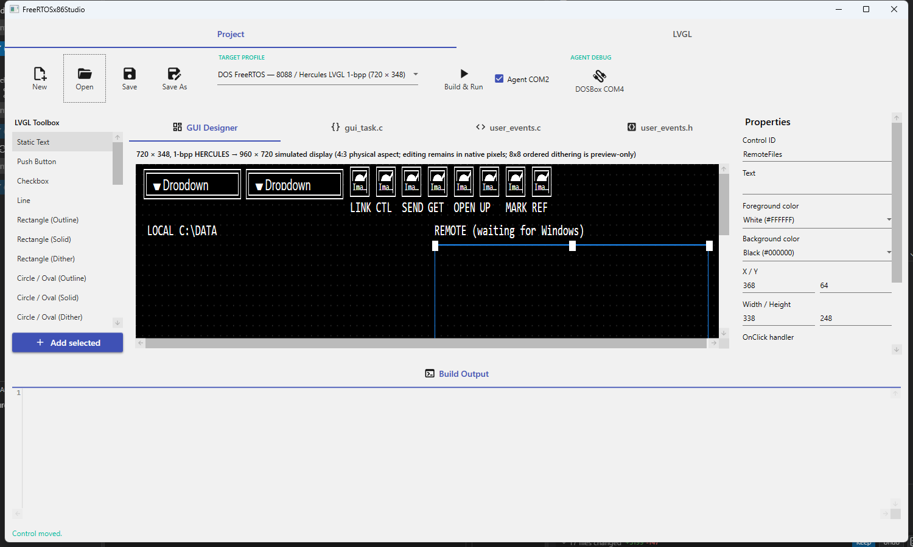

# DOS RTOS Workspace

This workspace contains the FreeRTOSx86Studio IDE and its 8088/Hercules DOS
runtime. The project plan is in [PROJECT_PLAN.md](PROJECT_PLAN.md). The current
GUI runtime target is 8088-compatible DOS with Hercules graphics; the
80386/VGA target is not implemented yet.

The root [.gitignore](.gitignore) keeps the workspace metadata and
`FreeRTOSx86Studio/` sources. Reference trees and local build dependencies
beside it—`ClassicMacStudio/`, `FreeRTOS-LTS/`, `ISA-PicoMEM/`, `dos-poc/`, and
`dosbox-x/`—are not included. Obtain the external dependencies separately as
described below.

## IDE screenshot

The IDE shown with the RetroLink tutorial demo project open:



## Requirements

- Windows 10/11 and the .NET 10 SDK for the IDE.
- Open Watcom 2.x for the 16-bit DOS runtime (the build scripts default to
  `C:\WATCOM`; set `WATCOM` if it is installed elsewhere).
- DOSBox-X for running the DOS target. The runtime script expects
  `dosbox-x\dosbox-x.exe` under this workspace root.
- Git to fetch the FreeRTOS LTS sources.

## Get the runtime sources and tools

Run these commands from `D:\Repository\dosrtos` in PowerShell.

### FreeRTOS kernel

The DOS runtime build uses the kernel and Open Watcom port from the FreeRTOS
202604 LTS collection. Clone that branch, including its library submodules,
into the location expected by the build scripts:

```powershell
git clone --branch 202604-LTS --recurse-submodules `
  https://github.com/FreeRTOS/FreeRTOS-LTS.git FreeRTOS-LTS
```

The build requires
`FreeRTOS-LTS\FreeRTOS\FreeRTOS-Kernel\tasks.c` and
`FreeRTOS-LTS\FreeRTOS\FreeRTOS-Kernel\portable\oWatcom\16BitDOS\PC\port.c`.
`FreeRTOS-LTS/` is a local dependency and is ignored by Git.

### LVGL

The DOS runtime already contains its Open Watcom-adapted LVGL source at
`FreeRTOSx86Studio\runtime\8088\third_party\lvgl-v8.3`. It is based on LVGL
commit `fbb73d4b3ffe086a7218bd1a8e51f9e7a260c4b9`; see that directory's
[UPSTREAM.md](FreeRTOSx86Studio/runtime/8088/third_party/lvgl-v8.3/UPSTREAM.md)
for the upstream URL and the DOS compatibility changes. No separate LVGL
download is needed for normal builds. Do not replace this adapted copy with a
pristine checkout.

To fetch the matching pristine upstream revision separately for reference:

```powershell
git clone https://github.com/lvgl/lvgl.git "$env:TEMP\lvgl-upstream"
git -C "$env:TEMP\lvgl-upstream" checkout `
  fbb73d4b3ffe086a7218bd1a8e51f9e7a260c4b9
```

### DOSBox-X

Download a Windows build from the
[DOSBox-X releases](https://github.com/joncampbell123/dosbox-x/releases) and
place `dosbox-x.exe` at `D:\Repository\dosrtos\dosbox-x\dosbox-x.exe`.
Emulator binaries and configuration assets are local and ignored by Git.

## Build the IDE

From the workspace root:

```powershell
dotnet restore .\FreeRTOSx86Studio\ClassicMacIde.slnx
dotnet build .\FreeRTOSx86Studio\ClassicMacIde.slnx -c Release
dotnet test .\FreeRTOSx86Studio\tests\ClassicMacIde.Core.Tests\ClassicMacIde.Core.Tests.csproj
dotnet run --project .\FreeRTOSx86Studio\src\ClassicMacIde.App\ClassicMacIde.App.csproj
```

The app project is a Windows WPF IDE. Open a saved `.x86gui` project and use
**Build & Run** to generate and launch it in DOSBox-X.

## Build and run DOS projects

The 8088 build script compiles the saved project using Open Watcom, the
FreeRTOS kernel/port above, and the bundled LVGL source. It then starts the
8088/Hercules DOSBox-X profile. For example, run the Hercules LVGL sample:

```powershell
.\FreeRTOSx86Studio\runtime\8088\build-and-run.ps1 `
  -ProjectDirectory .\FreeRTOSx86Studio\runtime\8088\examples\hercules-lvgl-demo
```

Run its bounded build-and-smoke test instead of the interactive app:

```powershell
.\FreeRTOSx86Studio\runtime\8088\build-and-run.ps1 `
  -ProjectDirectory .\FreeRTOSx86Studio\runtime\8088\examples\hercules-lvgl-demo `
  -SmokeTest
```

The RetroLink tutorial is also a buildable saved project:

```powershell
.\FreeRTOSx86Studio\runtime\8088\build-and-run.ps1 `
  -ProjectDirectory .\FreeRTOSx86Studio\tutorial\samples\retrolink
```

Its setup, COM-port mapping, and transfer instructions are in
[the RetroLink tutorial README](FreeRTOSx86Studio/tutorial/samples/retrolink/README.md).
The script can build any saved DOS `.x86gui` project by passing its directory
to `-ProjectDirectory`.

The runtime smoke test checks the generated GUI under DOSBox-X with an
8086-compatible CPU profile, 640 KiB conventional memory, and Hercules
graphics. It does not validate EMS, XMS, or a 80386/VGA target.
